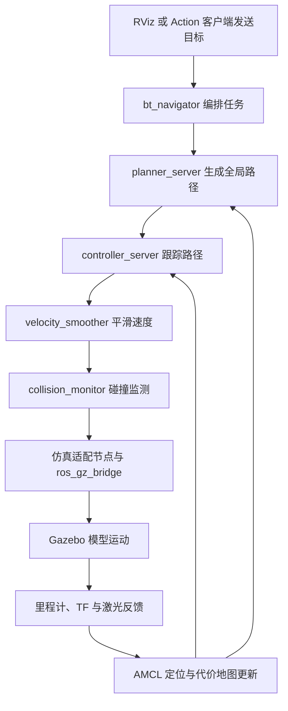

# Nav2 + Gazebo 基础教程：从认识组件到完成 AGV 导航

适用环境：Ubuntu 24.04、ROS 2 Jazzy、Gazebo Harmonic。实操使用本仓库已有的简化全向 AGV，不要求准备真实机器人。命令默认在 Bash 中执行。

学习目标：启动仿真，检查传感器和坐标变换，发送导航目标，观察规划与避障，理解常用配置，并能按数据流排查问题。

## 1. 先分清 Gazebo、RViz 和 Nav2

| 组件 | 负责什么 | 本教程中的例子 |
|---|---|---|
| Gazebo | 运行机器人和环境，生成模拟传感器与运动反馈 | 车体、墙、箱体、激光、实际模型位姿 |
| ROS 2 | 让程序通过话题、服务、Action 等接口协作 | `/scan`、`/odom`、`/navigate_to_pose` |
| ros_gz_bridge | 在 Gazebo Transport 和 ROS 2 之间转换消息 | 将模拟激光变成 ROS `LaserScan` |
| RViz | 显示 ROS 数据，提供交互工具 | 地图、激光点、路径、目标箭头 |
| Nav2 | 根据目标、定位和障碍物生成运动命令 | 规划绕障路线并跟踪到终点 |
| AMCL | 在已有地图中估计机器人位置 | 结合地图、激光和里程计定位 |
| SLAM Toolbox | 一边估计位置，一边建立地图 | 后续扩展建图时使用 |

Gazebo 中能看见机器人，只说明模型显示出来了；还需要传感器、运动反馈、TF 和控制链路，Nav2 才能工作。RViz 中出现路径，也不等于机器人已经执行并到达。

本教程采用“已有地图 + AMCL 定位 + Nav2 导航”。本项目地图由场景配置生成，首次练习无需先跑 SLAM。

Jazzy 与 Harmonic 是配套组合，参见 [Gazebo 官方 ROS 安装说明](https://gazebosim.org/docs/harmonic/ros_installation/)。本教程使用 `gz sim`、`ros_gz_sim` 和 `ros_gz_bridge`；不要混用旧教程中的 Gazebo Classic 插件。Nav2 的 [Jazzy 机器人接入指南](https://docs.nav2.org/jazzy/configuration_and_development/first_time_robot_setup_guide/)也区分了这两类仿真环境。

## 2. 理解导航的数据流

### 2.1 从目标到运动



本项目的实际速度话题链路是：

```text
controller_server / behavior_server
  → /cmd_vel_nav
  → velocity_smoother
  → /cmd_vel_smoothed
  → collision_monitor
  → /cmd_vel
  → agv_simulation_adapter
  → /sim/cmd_vel
  → ros_gz_bridge
  → Gazebo VelocityControl
```

全局规划回答“从哪里绕过去”；局部控制回答“下一刻以什么速度移动”。代价地图则告诉它们哪些区域危险。`bt_navigator` 使用行为树安排规划、跟踪以及失败时的恢复行为。

### 2.2 导航需要哪些输入

| 接口 | 类型 | 作用 |
|---|---|---|
| `/clock` | `rosgraph_msgs/msg/Clock` | 仿真时间 |
| `/scan` | `sensor_msgs/msg/LaserScan` | 激光观测，用于定位和障碍更新 |
| `/odom` | `nav_msgs/msg/Odometry` | 连续运动反馈，包含位姿和速度 |
| `/map` | `nav_msgs/msg/OccupancyGrid` | 先验栅格地图 |
| `/tf`、`/tf_static` | `tf2_msgs/msg/TFMessage` | 不同坐标系之间的关系 |
| `/cmd_vel` | `geometry_msgs/msg/Twist` | 本项目底盘速度输入 |
| `/navigate_to_pose` | `nav2_msgs/action/NavigateToPose` | 提交目标、接收反馈与最终结果 |

Nav2 各版本对速度消息类型的默认值可能不同。本项目显式关闭 `enable_stamped_cmd_vel`，使用 `Twist`；其他示例若使用 `TwistStamped`，应按实际接口发送。

### 2.3 必须理解的 TF 链

```text
map ── AMCL ──► odom ── Gazebo 里程计 ──► base_link
                                               │
                                      robot_state_publisher
                                               ▼
                                           laser_link
```

- `map`：地图参考系，适合表示目标和全局位置。定位校正可能使机器人在此坐标系中的估计位置跳变。
- `odom`：连续的局部参考系，适合短时间运动控制；真实里程计通常会累积漂移。
- `base_link`：车体坐标系，通常规定 x 向前、y 向左、z 向上。
- `laser_link`：激光安装坐标系，激光数据通过 TF 转换到车体或地图中。

`/odom` 消息和 `odom → base_link` TF 是两种不同接口，都应核查。每一段 TF 应有明确的发布者；不要为消除报错，随意补一个固定的 `map → odom` 来替代定位。

## 3. 环境准备与编译

### 3.1 安装前提

以下命令假设已经安装 ROS 2 Jazzy，并配置好 ROS 软件源。未安装时先按 [ROS 2 Jazzy 官方安装文档](https://docs.ros.org/en/jazzy/Installation/Ubuntu-Install-Debs.html)准备环境。

核心仿真与导航依赖：

```bash
sudo apt update
sudo apt install \
  ros-jazzy-ros-gz \
  ros-jazzy-navigation2 \
  ros-jazzy-nav2-bringup \
  ros-jazzy-rviz2 \
  ros-jazzy-robot-state-publisher \
  ros-jazzy-xacro \
  python3-colcon-common-extensions \
  python3-yaml
```

本仓库还包含机械臂、相机等包，以上列表不是整个工作区的全部构建依赖。已有工作区直接使用现有环境；首次配置还需参考 [README 的构建说明](../README.md#5-构建测试与运行)。

检查安装结果：

```bash
source /opt/ros/jazzy/setup.bash
printenv ROS_DISTRO
gz sim --versions
ros2 pkg prefix ros_gz_sim
ros2 pkg prefix nav2_bringup
```

预期 ROS 发行版为 `jazzy`，Gazebo Sim 主版本为 8（Harmonic）。不要为了符合教程安装其他发行版覆盖现有环境。

### 3.2 编译工作区

```bash
cd /home/zyj/Code/ROS2/AGV_new/AGV_ROS2_Control_Manager
source /opt/ros/jazzy/setup.bash
colcon build --packages-up-to agv_bringup \
  --cmake-args -DPython3_EXECUTABLE=/usr/bin/python3 -DBUILD_TESTING=ON
source install/setup.bash
```

仓库放在其他位置时修改 `cd` 路径。`--packages-up-to` 会连同工作区中的相关依赖一起构建；Python 路径使用系统解释器，避免误用缺少 ROS 模块的 Conda 环境。

## 4. 第一次运行：先让机器人完成一个目标

### 4.1 终端 A：启动整套仿真

在已完成上节编译和环境加载的终端运行：

```bash
ros2 launch agv_bringup agv_navigation_sim.launch.py
```

启动文件会生成场景、模型、地图和参数，启动 Gazebo；等待时钟、里程计和激光反馈就绪，再启动 AMCL、Nav2 与 RViz。

预期看到：Gazebo 中有 AGV、围墙和障碍物；RViz 中显示地图、机器人与激光；Navigation 2 面板显示导航已激活。出生点为 `(-4, -4)`，朝向为 0，启动配置自动设置了 AMCL 初始位姿。

这个入口不加载仙工或机械臂真实驱动。只启动一份仿真，不要同时启动真实整机入口 `agv.launch.xml`。

### 4.2 终端 B：设置相同的通信环境

**本教程后续 CLI、检查和实验均在设置了以下环境的终端中执行：**

```bash
cd /home/zyj/Code/ROS2/AGV_new/AGV_ROS2_Control_Manager
source /opt/ros/jazzy/setup.bash
source install/setup.bash
export ROS_DOMAIN_ID=187
export ROS_AUTOMATIC_DISCOVERY_RANGE=LOCALHOST
export GZ_PARTITION=agv_navigation_sim
```

启动文件只给自己的子进程设置这些变量，不会修改其他终端。ROS 域号控制 ROS 通信范围；Gazebo 分区控制 Gazebo Transport 通信范围。两者不是同一个设置。

先看节点并检查输入：

```bash
ros2 node list
/usr/bin/python3 tools/check_agv_navigation_inputs.py --timeout 8
```

正常应报告 `basic_inputs_present: true`。这只说明基础数据链路存在，不能证明定位精度或导航质量。

### 4.3 使用 RViz 发送目标

1. 确认 RViz 的 Fixed Frame 为 `map`，地图和激光正常显示。
2. 选择顶部 `Nav2 Goal` 工具。
3. 在可通行区域按住鼠标，再拖动箭头设置终点朝向。
4. 松开鼠标，观察全局路径、机器人移动和局部障碍变化。
5. 等待任务成功；需要中止时使用 Navigation 2 面板中的取消按钮。

第一次可选择目标 `(3, 3)`。中央障碍物位于 `(0, 0)`，机器人应从侧面绕过去。

`2D Pose Estimate` 是告诉定位系统“机器人现在在哪里”，不是让机器人去某个位置。本项目通常无需手动初始化；定位明显错误时，才按 Gazebo 中的实际位置和朝向重新设置。

### 4.4 使用 CLI 发送同一个目标

先确保上一个任务已经完成或取消，再执行：

```bash
ros2 action send_goal /navigate_to_pose nav2_msgs/action/NavigateToPose \
  '{pose: {header: {frame_id: map}, pose: {position: {x: 3.0, y: 3.0, z: 0.0}, orientation: {w: 1.0}}}}' \
  --feedback
```

目标位置单位为米。姿态用四元数表示，这里的 `(x=0, y=0, z=0, w=1)` 代表零旋转，即朝地图 x 正方向。纯平面 yaw 可换算为 `z = sin(yaw/2)`、`w = cos(yaw/2)`，角度单位为弧度。

Action 被接受只说明服务器接收了任务；持续 feedback 表示执行过程；最终 `SUCCEEDED` 才表示 Nav2 判定到达。按 CLI 的 Ctrl+C 不应当作服务器已经取消任务的证据，需要通过 RViz 取消并观察底盘停止。

### 4.5 结束运行

先取消尚未完成的目标，再在终端 A 按 Ctrl+C 关闭整套 launch。等待进程退出后再重启，避免重复的地图、时钟或 TF 发布者。

## 5. 第二次练习：观察基础数据

保持仿真运行，按下面顺序检查。`echo --once` 收到一条后退出，`hz` 和 `tf2_echo` 持续输出，观察完按 Ctrl+C。

### 5.1 时间和传感器

```bash
ros2 topic echo /clock --once
ros2 topic echo /odom --once
ros2 topic echo /scan --once --qos-reliability best_effort
ros2 topic hz /scan --qos-reliability best_effort
```

`/clock` 应持续递增；Gazebo 暂停后仿真时间也会暂停。使用仿真时间的节点应设置 `use_sim_time: true`，否则容易出现 TF 时间不匹配。

`/odom` 的参考系应为 `odom`，子坐标系应为 `base_link`。本项目由 Gazebo 模型实际位姿派生理想里程计，不能据此推断真实编码器精度。

`/scan` 的 `header.frame_id` 应为 `laser_link`，本配置有 720 条射线，频率约 10 Hz。部分射线为 `inf` 通常表示该方向没有量程内回波，应结合整帧数据和场景判断。

### 5.2 TF、生命周期和消息类型

```bash
ros2 run tf2_ros tf2_echo map base_link
ros2 run tf2_ros tf2_echo odom base_link
ros2 run tf2_ros tf2_echo base_link laser_link
ros2 lifecycle get /amcl
ros2 lifecycle get /planner_server
ros2 lifecycle get /controller_server
ros2 topic info /cmd_vel -v
```

正常导航时上述生命周期节点应为 `active`。`unconfigured` 表示尚未配置，`inactive` 表示已配置但未激活；进程存在并不意味着节点已能处理任务。

`topic info -v` 可检查消息类型和发布/订阅端。若接口类型或 QoS 不匹配，即使话题名字相同，也可能无法交换数据。

## 6. 地图、定位、代价地图分别解决什么问题

**先验地图**是静态环境描述。本项目使用 `map.pgm` 保存栅格图像，`map.yaml` 保存图像路径、米/像素分辨率、地图原点及占用阈值。世界范围为 x/y 各 `[-6, 6]`，分辨率为 `0.05 m/像素`。

**AMCL**在已有地图中估计位置。它结合里程计预测与激光观测更新定位；没有在这个流程中建立新地图。项目选择 `nav2_amcl::OmniMotionModel`，与可横移的简化底盘对应，参数含义参见 [Jazzy AMCL 文档](https://docs.nav2.org/jazzy/configuration_and_development/configuration_guide/others/configuring_amcl/)。

**代价地图**是规划与控制使用的栅格表示，将静态障碍、激光检测到的障碍和距离障碍的风险合并起来。本项目全局代价地图使用 `map`，局部代价地图使用 `odom` 并随车滚动。

| 配置层 | 用途 |
|---|---|
| `static_layer` | 加载先验地图中的墙和障碍 |
| `obstacle_layer` | 根据激光标记障碍、清除已观测到的自由区域 |
| `inflation_layer` | 在障碍周围增加代价，使路线留出距离 |

本场景有一个位于 `(2.5, -2.4)` 的箱体，它存在于 Gazebo，却没有画入先验地图。可以在 RViz 中比较 `/map` 与代价地图：箱体进入激光观测后，应在代价地图中成为障碍。观察这一点能帮助区分“按旧地图行驶”和“根据传感器更新避障”。

机器人外廓由 `footprint` 表示；膨胀半径决定障碍附近的代价分布，不能代替正确的车体尺寸。车体朝向不同，矩形通过窄通道的条件也可能不同。

## 7. 第三次练习：单独验证全向底盘

本项目简化底盘支持车体坐标系的前后 `vx`、左右 `vy` 和转动 `w`，没有模拟每个舵轮的转向过程。

**先取消所有导航任务，确认停止，并确保无人从 RViz 下发新目标。** 在空旷区域执行横移测试：

```bash
ros2 topic pub --rate 10 /cmd_vel geometry_msgs/msg/Twist \
  '{linear: {x: 0.0, y: 0.1}, angular: {z: 0.0}}'
```

运行约 2 秒后按 Ctrl+C，再发送零速度：

```bash
ros2 topic pub --once /cmd_vel geometry_msgs/msg/Twist \
  '{linear: {x: 0.0, y: 0.0}, angular: {z: 0.0}}'
```

预期机器人沿自身左侧移动，朝向基本保持。`linear.x > 0` 表示前进，`angular.z > 0` 表示从上方看逆时针旋转。

这里直接给 `/cmd_vel` 发布，是为单独检查仿真执行端，会绕过上游速度平滑和碰撞监测，仅在本隔离仿真中使用。适配节点会限速，并在 0.4 秒未收到新命令时归零；仍应检查模型实际停止。

若切换到真实驱动，应使用经确认的控制入口、命令仲裁和停车机制。差速底盘通常无法执行 `linear.y`，不能照搬全向设置。

## 8. 配置文件怎么读、怎么改

先从这些文件入手：

| 文件 | 学习重点 |
|---|---|
| [场景配置](../src/agv_bringup/config/agv_navigation_scene.yaml) | 出生点、车体尺寸、雷达高度、已知和未知障碍 |
| [Nav2 参数](../src/agv_bringup/config/agv_nav2_sim.yaml) | AMCL、DWB、代价地图、速度平滑和碰撞监测 |
| [仿真启动](../src/agv_bringup/launch/agv_navigation_sim.launch.py) | 消息桥接、话题重映射、启动顺序与生命周期 |
| [资源生成](../src/agv_bringup/agv_bringup_sim/assets.py) | 从同一场景生成 SDF、URDF、地图和最终参数 |
| [仿真适配](../src/agv_bringup/agv_bringup_sim/adapter.py) | 限速、输入超时归零、激光 frame 规范化 |

### 8.1 认识几个关键参数

| 参数 | 当前配置 | 改动时注意什么 |
|---|---|---|
| AMCL `robot_model_type` | `nav2_amcl::OmniMotionModel` | 需匹配底盘运动能力 |
| NavFn `use_astar` | `true` | 当前使用 A* 搜索全局路径 |
| DWB `max_vel_x` / `max_vel_y` | `0.45` / `0.35` m/s | 局部控制允许的分量上限 |
| DWB `max_speed_xy` | `0.45` m/s | x/y 合速度也受约束 |
| DWB `max_vel_theta` | `0.8` rad/s | 旋转速度上限 |
| `xy_goal_tolerance` | `0.15` m | 定位估计上的到位容差 |
| `yaw_goal_tolerance` | `0.15` rad | 终点朝向容差 |
| `inflation_radius` | `0.9` m | 障碍周围代价传播范围 |
| 激光观测源 `max_obstacle_height` | `2.0` m | 要覆盖雷达点转换后的高度 |

本项目雷达高 0.9 米；如果障碍层只接收更低的点，可能出现“RViz 看得见激光，代价地图却没有障碍”。应同时检查雷达 TF、观测源 topic 和高度范围。

DWB 跟踪过程与 goal checker 的平移容差应协调。配置中的 0.15 米针对 AMCL 估计位置，不能直接当成 Gazebo 真值误差，更不能当成实机精度保证。

### 8.2 一个简单练习：降低导航速度

在 `agv_nav2_sim.yaml` 中把 DWB 的 `max_vel_x` 改为 `0.25`、`max_vel_y` 改为 `0.20`、`max_speed_xy` 改为 `0.25`。同步将 `velocity_smoother.max_velocity` 改为 `[0.25, 0.20, 0.8]`，并将 `min_velocity` 的 x/y 下限及 DWB 的 `min_vel_x`、`min_vel_y` 分别收紧到 `-0.25`、`-0.20`。

关闭仿真，重新构建并启动：

```bash
colcon build --packages-select agv_bringup \
  --cmake-args -DPython3_EXECUTABLE=/usr/bin/python3 -DBUILD_TESTING=ON
source install/setup.bash
ros2 launch agv_bringup agv_navigation_sim.launch.py
```

下发相同目标，比较移动速度和完成时间。一次只做一类参数实验，方便判断原因；目标点靠近障碍时，也要观察是否仍有有效路线。

启动日志会打印 `AGV simulator assets: /tmp/agv-navigation-sim-...`。其中 `nav2.yaml` 是实际生成的参数，`map.yaml` 是实际地图。出生点、footprint 等会由场景配置覆盖生成，应检查最终文件，避免只看源 YAML 误判生效值。修改 `/tmp` 文件不作为长期配置，下次启动会生成新目录。

## 9. 启动选项与验证

```bash
# 关闭 RViz，保留 Gazebo 窗口
ros2 launch agv_bringup agv_navigation_sim.launch.py rviz:=false

# 两个窗口都不显示；GPU 雷达仍需要有效渲染环境
ros2 launch agv_bringup agv_navigation_sim.launch.py gui:=false rviz:=false

# 让 Nav2 保持未自动激活，观察生命周期
ros2 launch agv_bringup agv_navigation_sim.launch.py autostart:=false
```

只在上面第三种模式下，确认数据就绪后可通过生命周期管理器依次启动定位和导航：

```bash
ros2 service call /lifecycle_manager_localization/manage_nodes \
  nav2_msgs/srv/ManageLifecycleNodes '{command: 0}'
ros2 service call /lifecycle_manager_navigation/manage_nodes \
  nav2_msgs/srv/ManageLifecycleNodes '{command: 0}'
```

`command: 0` 表示 STARTUP。检查服务返回结果和节点状态；如果定位未正常激活，先排查定位，不要继续发送目标。逐个手动切换节点容易漏掉依赖，入门阶段使用默认 `autostart:=true` 即可。

本仓库已有验证工具：

```bash
# 只检查时钟、传感器和 TF，不发送运动命令
/usr/bin/python3 tools/check_agv_navigation_inputs.py --timeout 8

# 配置与资源生成回归，不需要启动 Gazebo
ctest --test-dir build/agv_bringup --output-on-failure

# 会移动机器人：在全新启动、仍处出生点且无其他任务的仿真中执行
/usr/bin/python3 tools/test_agv_navigation_sim.py
```

最后一个脚本检查横移、输入中断停车、未知障碍、规划、目标到达、取消和实际模型碰撞情况。默认结果位于 `/tmp/agv-nav-validation/navigation-result.json`，以实际退出码和完整结果判定。它不是本教程编写时重新运行的导航验证；已有实测记录见[全向导航使用说明](AGV全向底盘Gazebo导航使用说明.md)。

## 10. 按数据流排查常见问题

| 现象 | 优先检查 | 下一步 |
|---|---|---|
| Gazebo 启动了，CLI 看不到节点 | ROS 环境和域号 | 重新执行终端 B 的环境设置；不要先改导航参数 |
| RViz 没有地图 | `/map`、map_server 状态、Fixed Frame | 确认 map_server active，Fixed Frame 为 `map` |
| 雷达画面空白 | `/scan` 数据、QoS、雷达 TF | 使用 best_effort 读取，检查 `base_link → laser_link` |
| TF extrapolation 错误 | `/clock`、`use_sim_time`、消息时间戳 | 确认仿真未暂停，各组件使用相同时间源 |
| 一直等 `map → odom` | AMCL、地图、激光和初始位姿 | 确认 AMCL active，初始位置接近实际出生点 |
| 有路径，车不动 | 生命周期、各段速度、适配节点和模型反馈 | 沿 `/cmd_vel_nav` 到 `/sim/cmd_vel` 找首次缺失的位置 |
| 碰撞监测持续停车 | 激光新鲜度、车体附近障碍、TF | 查看 `/collision_monitor_state`，核查代价地图；不要直接关闭保护 |
| 看到激光但规划穿过箱体 | obstacle_layer topic、marking、高度范围 | 检查最终生成的参数与代价地图更新 |
| 目标被拒绝或规划失败 | 目标是否在地图内、车体外廓和通道宽度 | 先尝试空旷区域，避开障碍及过窄空间 |
| 靠近终点后反复转向 | 位置/朝向容差、停止阈值、定位与终点空间 | 核对 DWB 和 goal checker 的配置 |
| GUI 关闭后雷达也不正常 | GPU 渲染和 Gazebo 日志 | `gui:=false` 不代表 GPU 传感器无需图形环境 |

可以用下面的命令观察速度链路，每次检查一个话题，观察后 Ctrl+C：

```bash
ros2 topic echo /cmd_vel_nav
ros2 topic echo /cmd_vel_smoothed
ros2 topic echo /cmd_vel
ros2 topic echo /sim/cmd_vel
```

若更换配置后仍像旧版本，先检查 `ros2 pkg prefix agv_bringup` 是否指向当前工作区，再核对生成参数和重建结果。控制插件崩溃或缺少库符号的已有处理记录见 [Gazebo 环境搭建与验收](Gazebo环境搭建与验收.md)。

## 11. 后续如何学习 SLAM 和迁移到真机

### 11.1 从已有地图导航转向 SLAM

两种模式的定位来源不同：

```text
已有地图导航：map_server 发布 /map，AMCL 发布 map → odom
在线建图导航：SLAM 发布 /map 和 map → odom
```

切换时应保留机器人仿真、激光、里程计和 Nav2 规划控制部分，由 SLAM 替换 map_server 与 AMCL。本项目一键启动文件固定使用已有地图模式，没有 `slam:=true` 参数；不能在它旁边直接再启动一套 SLAM，让两个节点同时发布 `map → odom`。

扩展开发时可先拆分仿真与导航启动文件，再按 [Nav2 官方 SLAM 教程](https://docs.nav2.org/jazzy/tutorials/general_tutorials/navigation2_with_slam/navigation2_with_slam/)接入 SLAM Toolbox。地图创建完成后，用地图保存工具导出供后续定位：

```bash
# 在已有正常 /map 发布的终端环境中执行；保存到当前目录
ros2 run nav2_map_server map_saver_cli -f ./my_map \
  --ros-args -p use_sim_time:=true
```

保存地图不会自动改变当前启动入口。复用外部地图时还需配置独立导航启动文件及匹配机器人的参数。

### 11.2 从简化仿真转向真实 AGV

本模型通过机体速度直接运动，使用理想里程计，不模拟舵轮转向延迟、轮胎打滑及真实质量响应。它适合学习接口和导航流程。

真机接入时，重点替换并验证连续里程计、激光与安装 TF、速度执行和停车链路，并按真实外廓、速度、加速度重新配置导航。仙工地图定位坐标是否连续、是否受重定位影响，需要核实后才能用于 odom。上层 Action 接口可以延续，底层数据语义必须一致。

## 12. 建议学习顺序与资料

1. 按第 4 节完成一次目标导航，理解终点位置与朝向。
2. 按第 5 节检查 `/clock`、`/scan`、`/odom` 和 TF。
3. 比较静态地图与激光更新后的代价地图。
4. 单独验证横移，再做降低速度的参数实验。
5. 阅读 launch 的话题重映射，追踪完整速度链。
6. 运行已有验收脚本，再扩展 SLAM 或真实底盘接口。

项目资料：

- [全向底盘 Gazebo 导航使用说明](AGV全向底盘Gazebo导航使用说明.md)：现有功能、模型边界和实测结果。
- [Gazebo 环境搭建与验收](Gazebo环境搭建与验收.md)：本机环境、官方示例及库版本问题。
- [Nav2 Jazzy 入门](https://docs.nav2.org/jazzy/getting_started/)：官方入门入口。
- [Nav2 Jazzy Gazebo 接入指南](https://docs.nav2.org/jazzy/configuration_and_development/first_time_robot_setup_guide/gazebo/)：模型、里程计、传感器、定位和导航插件的分步接入。
