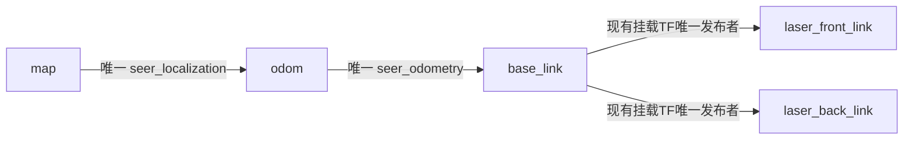
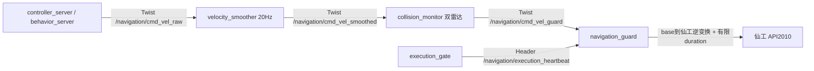

# Nav2 实机导航接入与验收

适用 ROS 2 Jazzy / Nav2 1.3.13（本机安装版本）/ C++17。默认模式不创建任何运动输出节点。
当前结论：**软件接线与离线规划通过；实机输入能恢复，但持续新鲜度未通过；实车运动未验收。**
未发送非零速度或 NavigateToPose/NavigateThroughPoses 目标，未抢占控制权、执行重定位或停止用户任务。

## 能力盘点与文件

| 模块 | 当前能力和复用方式 | 本次工作 |
| --- | --- | --- |
| lidar | 现有1009采集、设备时间推进检查、NaN未知测量、双扫描、诊断 | 直接复用，不融合成单扫描 |
| agv_description | 前后挂载TF、真实CAD模型 | 复用现有纯雷达描述入口；不加载ros2_control |
| robot_move/odometry | 连续实际速度积分、odom→base_link、接收时间近似 | 复用，不清零、不重启复用中的odom |
| robot_move/localization | 地图/质量检查、历史odom对齐、map→odom | 复用；确认开关保持false，不启动AMCL |
| robot_move/navigation | 已有CMake目标、可执行文件、配置、核心及ROS测试 | 增加base速度到仙工参考轴的逆变换、TF发布者检查、执行门禁心跳 |
| agv_bringup | 仿真、静态规划及通用Nav2入口 | 保持原入口；新增独立实机参数和启动入口 |
| 实车标定/网络 | 高度、后雷达外参、完整运动包络及输入采样时间未全部确认 | 保留待验收；不以放宽超时替代稳定性验收 |

新增文件：

- `src/agv_bringup/config/agv_nav2_real.yaml`：仅实机的Nav2配置。
- `src/agv_bringup/config/agv_navigation_commissioning.yaml`：默认全关闭的现场审核记录模板。
- `src/agv_bringup/launch/agv_navigation_real.launch.py`：observe/execute入口。
- `src/agv_bringup/agv_bringup_sim/real_navigation.py`：参数和审核记录校验、明确的节点/话题接线。
- `src/agv_bringup/agv_bringup_sim/execution_gate.py`、`scripts/agv_navigation_execution_gate`：实际参数、输入和控制通路检查，执行生命周期管理及独立心跳。
- `src/agv_bringup/config/agv_navigation_real.rviz`：地图、双雷达、TF、代价地图、轮廓及路径显示；不提供初始位姿或导航目标工具。
- `src/agv_bringup/test/test_real_navigation.py`：实际Jazzy插件配置、观察规划、类型/接线、执行门禁测试。

修改 agv_bringup 的CMake/依赖，以及 robot_move 的guard、速度变换和相关测试。已有用户修改、先前只读验证文档和图片保持原样；不提交或推送Git。

## 实机参数依据与限制

| 项目 | 当前配置 | 依据/仍需确认 |
| --- | --- | --- |
| 坐标 | map、odom、base_link、laser_front_link、laser_back_link | 与现有实际消息接口一致 |
| 底盘网格 | x≈±0.374829、y≈±0.623999m | `base_link.STL`，只含底盘，不能代表机械臂包络 |
| 完整零位包络 | x=[−0.374829,0.374829]、y=[−1.376299,1.373571]m | 对`agv.xacro`各collision STL顶点应用零位关节链和collision origin，取XY包围盒；包含机械臂与工具 |
| 初始footprint | x=±0.425，y=[−1.427,1.424]m | 完整零位包络外加约5cm工程余量。不是实车测量；只供观察规划，执行前必须实测并锁定机械臂/升降/工具姿态 |
| 运动模型 | DWB平面全向，允许x/y/旋转 | 现有API2010支持vx/vy/w，odom保留vy，项目全向底盘文档；仍需实车轴向、横移、组合运动验收 |
| 速度 | DWB合成线速度≤0.05m/s，角速度≤0.10rad/s | 调试软件上限，不是标定能力；平滑器各轴±0.05m/s，合成上限约0.071m/s，低于guard的0.15m/s |
| 加减速度 | 线0.10m/s²、角0.20rad/s²，减速参数负号 | 保守指令斜率；不证明实车制动能力，需测停车距离/时延 |
| 规划/控制 | Navfn A*、DWB、SimpleGoalChecker、SimpleProgressChecker | 本机Jazzy实际配置测试通过；XY/yaw到达容差0.10m/0.10rad，进展0.05m/20s |
| 代价地图 | global=map，local=odom滚动6×6m，0.05m分辨率 | static + 双雷达obstacle + inflation；局部不含static |
| 障碍处理 | marking/clearing；3.5m障碍、4m射线处理上限 | 工程处理范围，真实LaserScan仍报告设备量程，本轮实测0.001～40m、541束 |
| 高度 | layer及每个source均[−1,1]m | 当前map/odom/base变换z=0，雷达安装z=−0.24m，必须包含负高度；不是雷达离地标定 |
| 膨胀 | 半径1.65m、衰减系数3 | 大于当前长车体包络外接半径约1.49m的调试值；狭窄区可能不可通行，现场重验 |
| 更新期限 | 双scan0.6s；odom0.6s；定位/动态TF0.8s | guard和代价地图使用既有保护预算；不因当前断流增大期限 |

当前前雷达挂载(−0.295,−0.550,−0.240)m、yaw=−135°；后雷达(0.295,0.550,−0.240)m、yaw=54°。
后雷达yaw及相对高度仍是临时/静止对齐配置，不能当作独立测量结果。base_link离地高度未知。
若后续改变z、roll/pitch或map/odom的z定义，必须重新核对变换后的点云高度区间，并更新现场审核；执行门禁当前要求水平扫描面在该区间内。

未知/虚拟/无效束由现有驱动保留NaN；`inf_is_valid=false`，不会把未知测量替换为最大量程来清除障碍。
`footprint_clearing_enabled=false`避免用未核准车体包络抹掉观测。有限有效束可沿射线清除，旧观测不会获得新的时间戳。
障碍层`expected_update_rate=0.6`是**秒间隔**；它不是独立停车机制，停车仍由guard及执行心跳负责。

参数核对依据为本机`/opt/ros/jazzy/share/*/plugins.xml`、实际生命周期配置测试，以及Nav2官方
[Jazzy障碍层参数](https://docs.nav2.org/jazzy/configuration_and_development/configuration_guide/core_servers/costmap_2d/costmap_plugins/obstacle/)、
[Jazzy速度平滑器](https://api.nav2.org/nav2-jazzy/html/md_nav2_velocity_smoother_README.html)、
[Jazzy速度消息接口](https://api.nav2.org/nav2-jazzy/html/md_nav2_util_README.html)。
所有实机节点显式`use_sim_time=false`，所有速度端点显式`enable_stamped_cmd_vel=false`，使用Twist。

## TF、时间与速度链



不启动AMCL、SLAM或第二个map→odom发布者。默认复用现有采集与TF，不能同时启动旧显示入口和新一份同名输入。
自带雷达描述只发布两条固定挂载TF；如需完整RobotModel，复用整机描述和真实关节状态，零位预览不证明实车机械臂姿态。
定位按既有历史odom插值对齐；接收时间近似不能证明设备缓存样本的新鲜度。



控制器15Hz，平滑器20Hz，平滑器输入超时0.35s，guard指令超时0.5s，单请求150ms，duration=800ms。
800 > 500+150+20ms；这是预算关系，不是物理停车硬上界。目标固件到期制动仍未验证。
没有向原始`/cmd_vel`、`/legacy_cmd_vel`发布的旁路，没有额外底盘控制器。guard直接独占现有Client，不发布第二个速度输出话题。

新增`odometry::toSeer`是现有`toBase`的逆运算，包含旋转参考点ω×r补偿。
base相对仙工yaw=+π/2时，base前向速度转换为仙工+Y；不能直接把Nav2的base速度传到API。
guard、运行中的odom、定位节点三者的参考点/轴向必须完全一致；未确认的guard变换不能联网执行。

C++guard以DDS发布者GID检查所需TF的唯一发布者、父子关系及动态/静态所属话题；冲突锁定到重启。
Python Jazzy回调的MessageInfo没有publisher GID，因此执行门禁使用guard的`tf_ownership_valid`，不冒充能从Python回调证明发布者唯一。
静态TF收到后不要求周期重发；动态TF仍按原header检查新鲜度。

## 模式与门禁

**observe（默认）**只启动map_server、planner_server、独立planning生命周期管理器和可选RViz/只读输入。
不创建controller、behavior、BT navigator、速度平滑器、碰撞监测器或guard。独立规划器可以自动配置/激活并提供ComputePathToPose。
隔离来自节点/速度连接根本不存在，不依赖`autostart=false`。外部已经运行的控制器属于已有会话，不受本入口管理。

**execute**先核验现场审核文件、ROS地图YAML及图像SHA256、仙工地图名/MD5、guard双门禁及参考变换。
仓库模板均未放行，默认请求execute会在创建驱动前报错。
现场记录只是验收声明，不能替代测量，更不能仅为启动成功把false改true。

通过静态检查后，执行生命周期默认不激活。门禁读取**实际运行参数**核验guard全部配置、odom的发布/变换、定位确认/地图身份和map_server文件；
检查实时双scan的frame/量程/年龄、TF链、guard诊断、节点唯一性、Twist端点及专用话题接线。
检测到旧robot_move、controller_manager等竞争通路，或原始`/cmd_vel`/`/legacy_cmd_vel`订阅者时拒绝执行。
旁路控制SDK、外部控制客户端不一定出现在ROS图中，现场仍必须确认独占控制、没有用户正在执行的任务。

门禁先CONFIGURE执行插件，所有条件持续健康2s后RESUME；不发送目标或速度。
健康时以10Hz发送带原时间戳的执行心跳，guard要求0.4s内新鲜。图检查失败、门禁失联/崩溃或参数服务失联会停止心跳，
即使生命周期PAUSE服务失败，独立guard仍按心跳过期锁定并请求停车。Nav2自己也持续受scan/odom/定位/TF保护。
恢复数据不会自动恢复导航。Fault/StopRequested需要现场排障、guard显式recover、新命令和门禁显式重启；TF发布者变化需重启guard。
取消目标通常会产生显式零速，按现有guard规则进入StopRequested，不能直接开始下一次运动。
网络断开时本机零速可能送不达；不能把API应答或Fault状态写成“物理停车已确认”。

## 构建与启动

```bash
cd /home/zyj/Code/ROS2/AGV_new/AGV_ROS2_Control_Manager
source /opt/ros/jazzy/setup.bash
colcon build --symlink-install --packages-select agv_bridge robot_move lidar agv_hardware agv_description agv_bringup
source install/setup.bash
export ROS_DOMAIN_ID=216
# 每个参与终端/主机都使用同一domain，且按部署统一发现范围、RMW、系统时钟。
# 仿真默认187、旧静态规划默认188不能与实机216混用。
export AGV_MAP="$PWD/maps/seer/20251120141209997_navigable.yaml"

# 已有双雷达、odom、定位和TF时：默认复用它们。
ros2 launch agv_bringup agv_navigation_real.launch.py mode:=observe map:="$AGV_MAP" domain_id:=216
# 若已有map_server，再加reuse_map_server:=true；其地图文件须与AGV_MAP一致。
```

单独启动一套只读输入的示例（先确认不存在同名采集、TF、地图和规划器）：

```bash
# 现场定位YAML必须填写API1000准确地图名/MD5；保持尚未验收的确认开关为false。
# 不能用文件名推断控制器当前地图。地址用现场值，不写入仓库默认配置。
ros2 launch agv_bringup agv_navigation_real.launch.py mode:=observe map:="$AGV_MAP" \
  domain_id:=216 connection:=<控制器IP> rviz:=true \
  reuse_lidar:=false reuse_odometry:=false reuse_localization:=false reuse_description:=false \
  localization_params:=<现场定位.yaml>
```

每个`reuse_*`分别控制是否新建对应节点；缺少connection或发现重复节点会失败。
不启动完整`agv.launch.xml`、旧robot_move或ros2_control；这避免机械臂/整机入口顺带连接或初始化底盘。

下面是**未来验收放行后**的执行命令，本任务未运行。现场文件通过审核后才能使用：

```bash
ros2 launch agv_bringup agv_navigation_real.launch.py mode:=execute map:="$AGV_MAP" \
  domain_id:=216 connection:=<控制器IP> \
  params_file:=<已审核实机Nav2.yaml> guard_params:=<已审核保护.yaml> \
  commissioning_file:=<现场审核记录.yaml>
```

执行模式默认复用现有输入；仍不自动发目标。审核记录中的六项确认、`seer_map`、`seer_map_md5`以及两个SHA256必须与现场一致。
可用`sha256sum "$AGV_MAP" <地图图像文件>`取得文件哈希；哈希只锁定文件，不证明地图与现场一致。
输入新鲜度契约、duration/实际制动、底盘参考点/方向均未验收时保持仓库默认门禁关闭。

## 静止验收步骤

1. 只读API核对当前地图名/MD5/定位成功状态及置信度，对照转换报告、ROS图像、分辨率、原点和坐标轴。
   核对系统时钟、定位响应采样/接收时刻与历史odom匹配；不重定位、不清零odom。
2. 在observe模式显示地图、TF和双扫描。核对机器人位置/朝向及激光与墙面对应；分别检查前后扫描，不能只看融合效果。
   用独立测距/测角确认外参；前后TF各一个发布者、两条动态TF各一个发布者。
3. 检查global/local footprint是否包住实际机械臂、升降、工具和突出件，锁定运动期间姿态。
   observe只显示global代价地图；local代价地图及碰撞监测器先在模拟接口中验，再在后续已授权执行准备阶段检查。
4. 核对变换后的扫描点高度落入障碍过滤区间，检查墙体/近障碍标记、未知区、有效射线清除和膨胀边界。
   缺束/NaN不应形成自由空间。激光平面之外的低矮/悬空障碍无法仅靠这两台二维雷达保证检测。
5. 连续记录并发双scan、odom、定位、TF和diagnostics。统计消息年龄、样本间隔、窗口首尾缺口，不能只看平均Hz或末帧fresh。
   任一保护预算超限都不能放行连续执行；修网络后按同样负载复测，不能单纯增大超时。
6. 确认观察模式没有速度发布/订阅端点，再选择当前位置附近已知空闲点，仅调用规划动作：

```bash
ros2 topic list | rg 'cmd_vel|execution_heartbeat'  # 独立observe应无输出
ros2 lifecycle get /planner_server               # 应为active；缺TF时可能等待
ros2 param get /seer_localization map_alignment_confirmed
ros2 param get /seer_localization base_transform_confirmed
# X、Y为现场核对过的附近地图坐标。这里只计算路径，不调用navigate_to_pose。
ros2 action send_goal /compute_path_to_pose nav2_msgs/action/ComputePathToPose \
  '{goal: {header: {frame_id: map}, pose: {position: {x: <X>, y: <Y>}, orientation: {w: 1.0}}}, planner_id: GridBased, use_start: false}'
```

若TF/地图/输入不新鲜，记录不能规划，不伪造初始位姿或改确认开关。现场截图核对、代价地图检查和附近路径规划分别记录通过与否。

## 后续实车运动验收（必须另外明确授权）

确认设备、空旷区域、监护人/急停、测试时长与独占控制；先验证固件duration到期、实际速度反馈及物理制动时间/距离。
完成输入采样时间/缓存契约与包络/轴向标定，再由现场负责人放行低速短距离导航。

| 验收项 | 注入/操作 | 必须观察的结果 |
| --- | --- | --- |
| 到达附近目标 | 经授权发送短距离目标 | 低速遵守限幅；位置/朝向容差满足，目标结束停车 |
| 取消目标 | 取消正在执行的目标 | 清除旧命令、请求零速、实际速度降至阈值；恢复需显式操作 |
| 指令中断 | 停止Nav2命令流/门禁心跳 | watchdog/心跳到期停车并锁定；不能重放旧命令 |
| 前/后雷达过期 | 分别中断一个源、重复旧帧 | 单源失效即拒绝执行/停车，不以另一源健康替代 |
| odom过期 | 中断实际反馈 | 请求停车且不得报告实际停车确认；连续odom不被自动清零 |
| 定位/TF过期 | 中断定位/动态TF，输入错误地图/质量 | 锁定停车，不依靠缓存TF维持执行 |
| 控制通信失败 | 经授权隔离控制链路 | 有界零速尝试；失败报告未确认，独立测量固件到期停车 |
| 障碍前停止 | 放置可检测目标 | 碰撞监测/代价地图阻止碰撞，测量停止距离与最差时延 |
| 恢复 | 排障、guard recover、显式重启门禁、新目标 | 不自动重连抢权，不因数据恢复或旧目标恢复而运动 |

记录应用请求、API ACK、反馈停车和独立物理停车各自时刻。断网、进程崩溃/掉电场景不能由本机ACK证明停车。
详细状态机和固件限制见[导航停止机制](导航停止机制.md)。

## 本轮验证结果（2026-11-12）

六包构建成功。[软件验证记录](validation/nav2_real_software_2026-11-12.json)汇总本轮结果及最终定向测试输出。
五个相关包CTest顶层30项，28项通过，2项既有失败：

| 包 | 通过/总数 | 结果 |
| --- | --- | --- |
| robot_move | 18/19 | 13项功能测试通过；uncrustify既有格式分歧 |
| lidar | 4/4 | 源、NaN处理、节点、并发接口全部通过 |
| agv_hardware | 3/4 | chassis_model_test仍使用旧launch XML查找路径，NoneType.attrib失败 |
| agv_description | 1/1 | 双雷达安装TF回归通过 |
| agv_bringup | 2/2 | 原仿真/静态资产8例 + 新实机ROS集成6例通过 |

新增集成测试实际配置并加载Navfn、DWB及critics、进展/到达检查、路径平滑、behavior、BT、速度平滑和双scan碰撞监测器。
在隔离域214只用合成地图、TF/scan/诊断及假底盘接口，验证observe没有任何cmd_vel端点仍可规划、execute默认拒绝、
Twist接线、真实生命周期CONFIGURE/RESUME、缺输入/过期/未核验不激活、雷达恢复不自动解除锁定。
C++假发送器ROS测试覆盖雷达/odom/TF/定位及门禁心跳分别失效、指令超时、显式恢复、重复TF发布者锁定；
速度逆变换测试包含+90°方向和非零参考点的正反变换一致性。所有这些测试不连接真实控制器。

既有失败与[导航停止测试记录](导航停止测试记录.md)中同名失败一致；未为消除它们重排旧代码或更改旧模型测试。
最终追加执行心跳后，两包重建成功；agv_bringup完整CTest再次2/2通过（15.50s），
robot_move的navigation_node_test、navigation_guard_test、odometry_test再次3/3通过，包含未确认变换在联网前拒绝的断言。
本轮新增导航C++文件的单独uncrustify和`git diff --check`通过。colcon聚合xUnit会重复统计外层/文件级失败，不能把其30个failure理解为30项功能失败。

真实只读记录：[65秒输入与实际参数](validation/nav2_real_readonly_2026-11-12.json)、
[附近规划检查](validation/nav2_real_plan_2026-11-12.json)。初始API1000多次超时/连接失败；后续只读流恢复，
定位节点按历史预期地图名`20251120141209997`/MD5锁定并成功发布TF。确认开关均保持false。
使用现有确认版odom轴向、原始雷达参数、临时现场定位文件，仅填写预期地图身份，不提升标定确认。

| 输入 | 频率 | 到达年龄P95/最大 | 采集中最大相邻间隔 | 含启动/窗口边界最大空缺 |
| --- | --- | --- | --- | --- |
| odom | 4.69Hz | 0.001/0.002s | 0.578s | 2.417s |
| odom→base_link | 4.69Hz | 0.002/0.002s | 0.578s | 2.417s |
| 前/后扫描 | 各3.78Hz | 0.283/0.834s | 1.758s | 2.585s |
| map→odom | 1.80Hz | 0.241/0.406s | 1.650s | 3.385s |

两台实际frame正确，量程0.001～40m，541束；所有查询到的节点use_sim_time=false。
odom实际base_yaw=+π/2、publish_tf=true；定位两项确认仍false；地图服务器实际加载navigable YAML。
窗口内速度话题为空；没有运动驱动、AMCL或额外动态TF发布者。最后一帧diagnostics为fresh不代表中途没有断流。
定位coordinate_status仍为UNVERIFIED_ASSUMPTION，输入采样仍为接收时间近似。
观察过程中规划管理器曾报告active，但单独附近路径检查未在其有效窗口内取得可用TF/规划服务，**实机附近路径未通过**，
不据离线测试或曾active推断现场规划成功。这里没有新增人工RViz目测验收；先前目测记录独立保留。

本次启动的只读进程已按所属进程组关闭；没有结束其他会话或停止控制器任务。
剩余必须验收：网络并发稳定性、真实采样时间/缓存语义、定位及地图量化标定、雷达高度/外参、机械臂锁定包络、
全向轴向/动态限制、静止代价地图现场核对、实机附近路径、固件到期与故障停车、实际到达/障碍停止及恢复。

复现命令：

```bash
colcon test --packages-select robot_move lidar agv_hardware agv_description agv_bringup --event-handlers console_direct+
colcon test-result --verbose
ctest --test-dir build/robot_move -R 'navigation_(guard|node)_test|^odometry_test$' --output-on-failure
ctest --test-dir build/agv_bringup --output-on-failure
```

## 新IP有线复测更新

2026-11-12更换为192.168.192.5后，已完成[两分钟只读复测](Nav2新网段只读验收_2026-11-12.md)。
本窗口双雷达/odom最大相邻间隔约0.34s、map→odom约0.65s，观察端新鲜度覆盖无空缺；三次附近路径计算均成功。
这补充了上文旧网络下未成功的附近路径检查，不覆盖或删除旧记录。
但定位诊断反复waiting_for_odom_bracket以及代价地图TF过滤丢弃仍存在，执行准入未通过；确认开关和运动门禁保持关闭，未测试实际运动。
