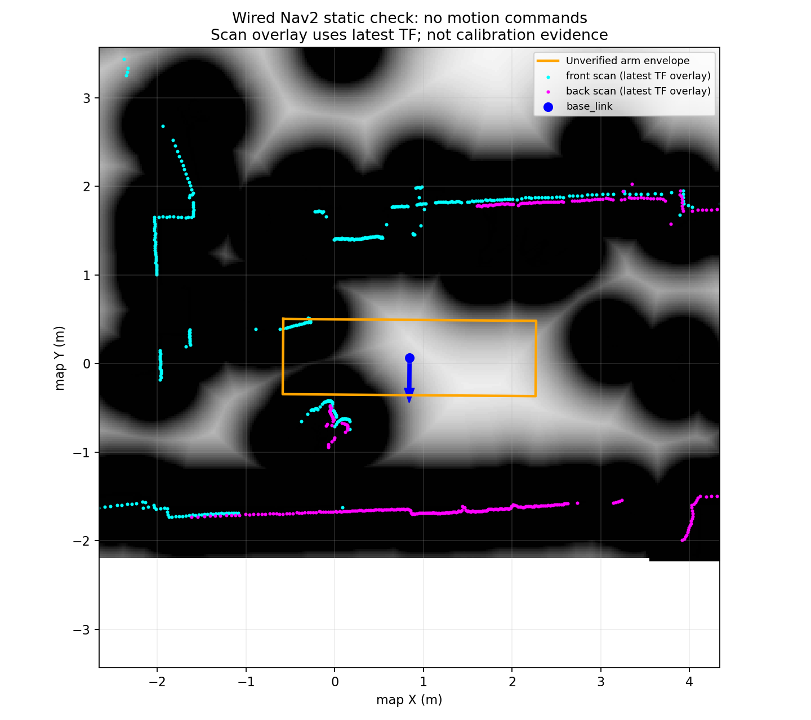

# 新IP有线网络下的Nav2只读验收

时间：2026-11-12 14:59～15:01，持续约120.09秒。控制器192.168.192.5，本机192.168.192.105，经eno1有线连接；ROS_DOMAIN_ID=216。

**结论：本窗口的通信接收连续性和附近路径规划通过；完整导航执行准入仍未通过；实际运动未测试。**
未发送速度、NavigateToPose/NavigateThroughPoses目标、控制权抢占、DO或重定位请求，没有放开任何确认或运动门禁。
仅调用ComputePathToPose进行计算，不驱动车辆。本次启动的只读进程已按所属进程组关闭，没有结束其他任务。

## 环境与地图

只读身份查询成功：current_map=`20251120141209997`，MD5=`342c6d27a3ad34d10d2bd44899c4578b`，reloc_status=1，confidence=0.7745。
ROS加载对应`20251120141209997_navigable.yaml`。

复用现有雷达、odom、定位、安装TF模块，通过`agv_navigation_real.launch.py mode:=observe`启动；不启动底盘驱动或Nav2执行节点。
启动前检查没有同名输入节点，避免重复启动。现场配置只补充当前地图名/MD5，定位的map_alignment_confirmed和base_transform_confirmed仍为false。
所有查询到的节点use_sim_time=false，雷达、odom和定位的实际connection均为新地址。

## 两分钟统计

[完整记录与实际参数](validation/nav2_wired_readonly_2026-11-12_145927.json)。表中统计为观察端数据，不代表设备内部实际采样年龄。

| 输入 | 含启动平均Hz | 到达年龄P95/最大 | 最大相邻到达间隔 | 新鲜度期限 |
| --- | --- | --- | --- | --- |
| /odom | 4.89 | 0.064/0.131s | 0.342s | 0.6s |
| odom→base_link | 4.89 | 0.064/0.131s | 0.342s | 0.6s |
| /scan_front | 4.89 | 0.081/0.152s | 0.335s | 0.6s |
| /scan_back | 4.89 | 0.081/0.153s | 0.334s | 0.6s |
| map→odom | 1.95 | 0.231/0.499s | 0.650s | 0.8s |

首个odom/扫描约在启动后2.7秒到达，首个map→odom约3.7秒到达；启动等待没有被算成稳定运行。
收到首个有效消息后，逐条按原时间戳年龄扣减剩余期限，再检查到下一条消息前的覆盖：这五个输入在本观察端均无新鲜度空缺。
不只比较平均频率或单独的间隔；保留启动与末端空缺字段。两分钟结果不能代替长时间/运动负载或设备内部缓存语义验收。

雷达自身诊断稳定频率约4.998Hz，errors=0、duplicates=0、clock_resets=0；odom errors=0、reconnections=0、skipped_integrations=0；定位query_failures=0。
前后扫描frame正确，量程0.001～40m，541束；未知束仍保留非有限值，没有转成最大量程。
相比旧无线记录的雷达1.758秒、map→odom 1.650秒最大相邻间隔，本窗口明显改善。

## 附近路径与代价地图

在第25、60、95秒分别调用`/compute_path_to_pose`，从当前地图位置(0.8439,0.0669)m沿base_link前向选取约0.3m附近点。
三次均返回status=4、error_code=0和30个路径点。目标约为(0.84156,−0.23309)m；base_link轴相对仙工轴旋转+π/2，不能按地图X方向理解车辆前向。
请求前先确认规划器active、map→base_link时间年龄小于0.8s、目标在代价地图内且不是未知/致命障碍单元。
这些是规划动作，绝非发送实车导航目标，也不证明矩形长车体一定可执行此路径。

全局代价地图成功发布，1994×644、分辨率约0.02m（跟随静态地图）；扫描源仍分别为front/back，inf_is_valid=false，最低高度−1m、膨胀半径1.65m。
发布的footprint与当前配置一致；它是完整URDF零位包络加余量，尚未现场确认机械臂锁定姿态，不能因此认定真实车体轮廓标定通过。
观察模式没有局部控制代价地图或运动执行节点，本轮不宣称局部避障、碰撞监测实际停车通过。

该图是静止快照，扫描叠加使用最新TF，不能作为严格同时间外参标定证据。橙色为尚未核准的机械臂包络，蓝色为base_link。
图中部分近处扫描点接近或落入临时轮廓，需现场核对自体回波、真实障碍及锁定姿态，不能凭图认定实车已经碰撞或轮廓正确。
绘图订阅器启动较晚，没有收到规划话题的新一次发布，因此图中不展示路径；路径成功依据是三次动作返回，详见JSON。

## 仍未通过的执行条件

1. **定位诊断仍反复进入等待odom插值状态。** 本窗口收到396条`level=2 / waiting_for_odom_bracket`诊断，最终状态恢复为receive_time_approximation，查询本身无失败。
   代码在新定位样本尚无前后odom包围时等待重试；这与网络断流不是同一问题。
   按现有guard的`level<=1`、`tf_available=true`及允许状态文本要求，这些等待状态会使定位输入无效。
   因此即使消息到达新鲜度合格，也不能推断保护输入全程健康或执行门禁可通过。此结论来自诊断与现有条件核对，本轮没有启用运动来试错。
2. **代价地图仍有扫描/TF时间过滤丢弃。** 捕获44条“timestamp earlier than all data in transform cache”日志；日志可能节流，44不是总丢帧数。
   [过滤日志](validation/nav2_wired_tf_filter_2026-11-12.log)已归档。不能把代价地图成功发布或规划成功当作每帧扫描都正确进入障碍层的证明。
   根因本轮未确定，需单独检查TF缓存、消息过滤和时间对应关系；未用放宽超时、伪造时间戳或重复发布TF掩盖。
3. 定位坐标确认、雷达高度/外参、实际机械臂包络、设备内部采样时间/缓存契约、固件duration和实际故障停车仍待验收。

ROS图中双扫描和odom各一个发布者；挂载TF由一份现有纯雷达描述发布，两条动态TF来源为现有odom/定位节点。
robot_state_publisher还会创建空的动态TF发布端点，不能凭`/tf`端点数量直接判断某条变换重复；本轮Python快照不冒充DDS逐边GID仲裁。
未观察到AMCL、运动驱动、重复采集节点或速度话题；`/cmd_vel`、`/legacy_cmd_vel`和`/navigation/cmd_vel_guard`发布/订阅端点均为空。

下一步应先处理定位诊断与TF时间过滤问题，再静止复验保护输入和现场标定，之后才另行授权低速运动与停车验收。
软件接入、静止规划成功和实际运动验收分别记账，不能互相替代。
