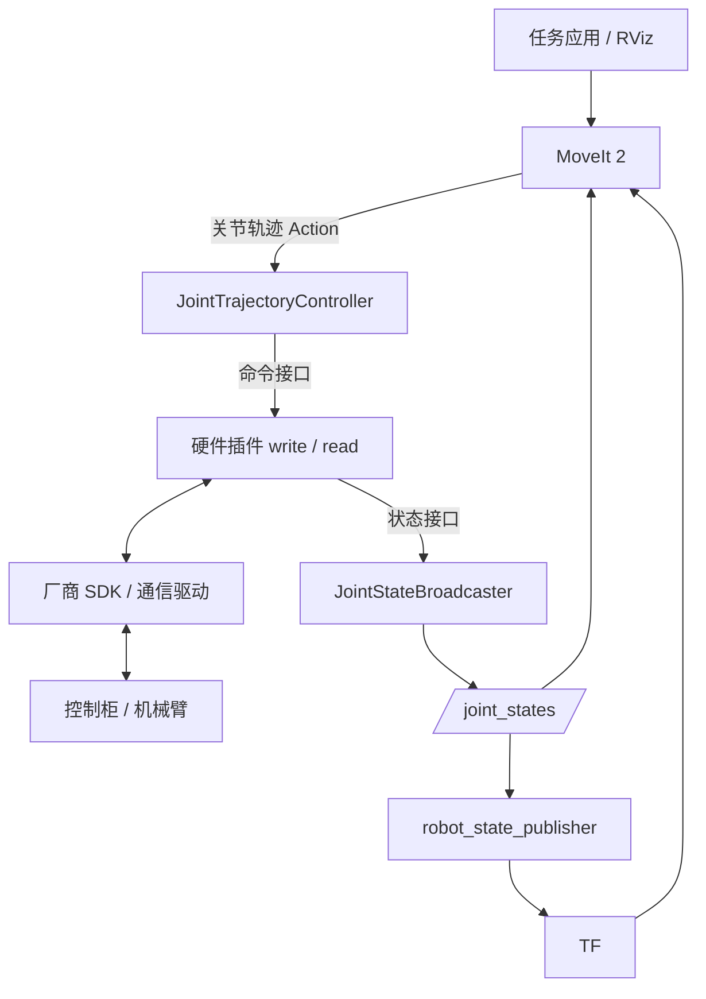

# ROS 2 机械臂开发完整指南：从模型到真实硬件

编写日期：2026-11-03。以本项目使用的 ROS 2 Jazzy、C++17、ros2_control、MoveIt 2 为背景。

本文给出一条完整的开发路线，解释各层负责什么、配置如何对应、命令如何到达设备、状态如何返回，以及怎样逐层验证。它不是某一型号机械臂的 SDK 手册。设备的运动模式、控制周期、停止方式及单位转换，最终需要按对应厂商手册实现。

**阅读约定：**“标准链路”描述通常的架构；“本工程现状”来自当前源码检查；“示例”用于解释设计，不代表已经接入本工程或经过实机验证。此次仅新增文档，没有修改控制代码、启动设备或执行机械臂运动。

## 目录

1. [先认识整个系统](#1-先认识整个系统)
2. [ROS 2 必备概念](#2-ros-2-必备概念)
3. [机械臂基础：关节、位姿、运动学和单位](#3-机械臂基础关节位姿运动学和单位)
4. [工作区与软件包组织](#4-工作区与软件包组织)
5. [URDF、Xacro 与机器人模型](#5-urdfxacro-与机器人模型)
6. [TF、JointState 与当前机器人状态](#6-tfjointstate-与当前机器人状态)
7. [ros2_control 与硬件接口基类](#7-ros2_control-与硬件接口基类)
8. [硬件插件怎样实现](#8-硬件插件怎样实现)
9. [轨迹控制器与控制器配置](#9-轨迹控制器与控制器配置)
10. [MoveIt 2 怎样规划和执行](#10-moveit-2-怎样规划和执行)
11. [应用层与任务执行](#11-应用层与任务执行)
12. [相机、标定、工具与环境](#12-相机标定工具与环境)
13. [实时通信、线程与资源管理](#13-实时通信线程与资源管理)
14. [错误处理与运动结果](#14-错误处理与运动结果)
15. [Launch、参数与部署](#15-launch参数与部署)
16. [测试与分阶段验收](#16-测试与分阶段验收)
17. [常用调试命令与故障定位](#17-常用调试命令与故障定位)
18. [本工程对应关系及当前边界](#18-本工程对应关系及当前边界)
19. [建议的开发顺序](#19-建议的开发顺序)
20. [术语与官方资料](#20-术语与官方资料)

## 1. 先认识整个系统

开发机械臂，最终需要打通两条链路：

```text
命令方向：
任务应用 / RViz
    → MoveIt：根据目标、机器人模型、障碍物生成轨迹
    → FollowJointTrajectory Action：提交带时间的关节轨迹
    → joint_trajectory_controller：按控制周期计算当前应执行的参考值
    → ros2_control 硬件插件的 write()
    → 厂商 SDK / 总线 / 网络协议
    → 机器人控制柜与电机

反馈方向：
机器人传感器 / 控制柜
    → 厂商 SDK
    → 硬件插件的 read()
    → ros2_control 状态接口
    → joint_state_broadcaster
    → /joint_states
    → robot_state_publisher、MoveIt、RViz
```

这里的“当前应执行的参考值”与机器人内部电流环、速度环不是一回事。多数工业机械臂仍由厂商控制柜完成底层伺服闭环；ROS 侧根据开放能力提交关节参考值或完整运动任务。



RViz 负责显示和交互；MoveIt 负责规划与执行协调；轨迹控制器负责轨迹跟踪接口；硬件插件负责适配设备。这些职责需要分别实现。

### 1.1 两种设备接入路线

| 路线 | 适合的设备能力 | 主要实现 |
|---|---|---|
| 周期参考值控制 | SDK支持稳定周期的关节位置/速度/力矩接口 | ros2_control + 轨迹控制器 + 硬件插件 |
| 控制柜执行完整任务 | SDK主要提供moveJ/moveL、轨迹上传及任务查询 | 驱动提供轨迹Action适配，交给控制柜执行 |

第二种路线也可以与 MoveIt 对接，但需要自行处理轨迹语义、执行反馈、取消和容差，不能仅凭一个“发送关节目标”函数就宣称支持 `FollowJointTrajectory`。

应先明确设备控制能力，再决定执行架构。不要把本来执行数秒的非实时moveJ接口，放进每毫秒调用的`write()`里重复提交。

## 2. ROS 2 必备概念

### 2.1 Node、Topic、Service、Action、Parameter

| 概念 | 作用 | 机械臂中的例子 |
|---|---|---|
| Node | 运行ROS逻辑的对象，可以发布、订阅和调用接口 | robot_state_publisher、move_group |
| Topic | 连续或事件消息流 | `/joint_states`、相机图像 |
| Service | 一次请求和一次响应 | 查询配置、切换某个设置 |
| Action | 带反馈、结果、取消语义的长任务接口 | 执行一条机械臂轨迹 |
| Parameter | 节点的配置项 | 规划时间、控制器关节列表 |

接口文件分别是`.msg`、`.srv`和`.action`。Action适合需要持续跟踪进度的运动任务；普通Topic本身没有任务完成确认。参见[ROS 2官方接口说明](https://raw.githubusercontent.com/ros2/ros2_documentation/jazzy/source/Concepts/Basic/About-Interfaces.rst)。

Node是C++/Python中的ROS对象，进程是操作系统运行单元；一个进程可以包含多个Node。硬件插件也可以由宿主进程加载，不必自己定义`main()`。

### 2.2 Executor 与回调

订阅、定时器、Service和Action的回调，需要executor调度。

```text
ROS消息到达 → 回调等待执行 → executor调度 → 用户回调
```

单线程executor一次执行一个回调。如果在订阅回调里等待机械臂完成30秒运动，同一executor上的其他回调也可能被阻塞。多线程executor需要配合callback group、共享状态同步和清楚的任务归属，不能直接把所有回调放到多线程里就认为问题解决。

### 2.3 QoS、发现与时间

QoS决定消息的可靠性、保留策略和队列等行为。排查“能看到Topic却收不到消息”时，检查发布端与订阅端的QoS兼容性，而不只看Topic名字。高频传感器常使用best effort，模型等需要晚加入订阅者获取的内容可能使用transient local；应以实际接口要求为准。参见[ROS 2官方QoS说明](https://raw.githubusercontent.com/ros2/ros2_documentation/jazzy/source/Concepts/Intermediate/About-Quality-of-Service-Settings.rst)。

跨机器通信还需要检查`ROS_DOMAIN_ID`、网络发现及防火墙配置。

时间要区分：

- ROS时间：消息时间戳、TF查询、仿真时间。
- 单调时钟：网络超时、重试期限等本地持续时间。
- 控制周期：控制循环实际两次更新之间的时间。

使用仿真时间的节点需要一致配置`use_sim_time`；超时控制不宜依赖会跳变或暂停的仿真时钟。

## 3. 机械臂基础：关节、位姿、运动学和单位

### 3.1 关节空间与笛卡尔空间

六轴机械臂的关节目标可以写成：

```text
q = [q1, q2, q3, q4, q5, q6]
```

末端目标则包含位置和姿态：

```text
位置：x, y, z
姿态：四元数 x, y, z, w
```

正运动学FK：根据关节角，求末端位姿。逆运动学IK：根据末端位姿，求满足条件的关节角。IK可能没有解，也可能有多个解；还需检查限位、碰撞、姿态约束和相邻目标间的关节连续性。

雅可比矩阵描述关节速度与末端速度的局部关系。接近奇异位形时，较小的末端运动也可能需要很大的关节速度。

### 3.2 单位必须统一

| 数据 | ROS常用单位 | 常见设备接口差异 |
|---|---|---|
| 旋转关节位置 | rad | degree |
| 移动关节位置、空间位置 | m | mm |
| 旋转速度 | rad/s | degree/s |
| 线速度 | m/s | mm/s |
| 关节力矩 | N·m | 原始电流或厂商刻度 |

例如：`180 degree = π rad`，`100 mm = 0.1 m`。默认采用右手坐标系，机体常用x向前、y向左、z向上；相机光学坐标通常z向前、x向右、y向下。标准依据见[REP-103](https://raw.githubusercontent.com/ros-infrastructure/rep/master/rep-0103.rst)。

厂商可能提供RPY、旋转向量、轴角或不同欧拉角顺序。六个double并不自动意味着`[x,y,z,roll,pitch,yaw]`；必须明确它们的单位、顺序、坐标系和旋转定义。

建议仅在SDK适配边界转换单位和关节方向，例如`q_ros = direction × q_sdk + offset`，并保证命令方向使用其逆转换。不要在多个回调中分散转换。

### 3.3 路径与轨迹

```text
路径：经过哪些位置。
轨迹：在什么时间，以怎样的速度和加速度经过这些位置。
```

`PoseArray`可以表示一系列位姿，但没有每个点的到达时刻；`JointTrajectory`则包含关节名字、轨迹点以及各点的`time_from_start`。把位姿数组逐点发给SDK，不会自动保留MoveIt原有的时间和速度约束。

## 4. 工作区与软件包组织

建议按职责划分包：

```text
workspace/
├── src/
│   ├── arm_description/       # URDF、Xacro、网格、工具模型
│   ├── arm_driver/            # 厂商SDK与通信封装
│   ├── arm_hardware/          # ros2_control硬件插件
│   ├── arm_moveit_config/     # SRDF、运动学、规划及执行配置
│   ├── arm_bringup/           # 启动入口和设备参数
│   ├── arm_tasks/             # 抓取、检测、扫描等任务逻辑
│   └── arm_interfaces/        # 必要的自定义消息/Action
├── build/
├── install/
└── log/
```

这些是职责边界，不要求立即拆成七个包。小项目可以把SDK封装与硬件插件放在一个包内，但应在类和文件层面保持边界。

基本开发工具是`ament_cmake`、`colcon`、`rosdep`、CMake和`package.xml`。头文件提供声明，库提供编译后的实现；跨包复用C++类通常既要声明包依赖，也要链接导出的库。

本工程根目录就是工作区：

```bash
source /opt/ros/jazzy/setup.bash
cd /home/zyj/Code/ROS2/AGV_new/AGV_ROS2_Control_Manager
colcon build --packages-up-to agv_hardware agv_bringup
source install/setup.bash
```

`--packages-up-to`会构建所选包及其工作区依赖；`--packages-select`适合依赖已经构建好的增量开发。另一个终端使用代码前，也需要加载对应的`install/setup.bash`。

本机默认`python3`曾指向Anaconda 3.7，ROS Jazzy工具使用系统Python。遇到ROS Python导入错误，先检查解释器和环境，必要时给CMake指定`-DPython3_EXECUTABLE=/usr/bin/python3`，不要盲目把ROS依赖装进另一套Python。

## 5. URDF、Xacro 与机器人模型

### 5.1 URDF描述什么

URDF用link表示刚体，用joint连接两个link，形成机器人树。每个joint需要正确的父子关系、安装位置、旋转/移动轴和关节类型。

| 字段 | 作用 | 常见错误 |
|---|---|---|
| `origin` | 相对父坐标系的安装变换 | 把CAD世界坐标直接当局部坐标 |
| `axis` | 关节轴，在关节坐标系中表达 | 轴方向反了或坐标系理解错误 |
| `limit` | 位置、速度、力矩限制 | 度与弧度混用 |
| `visual` | 显示用几何体 | 网格尺寸差1000倍 |
| `collision` | 碰撞检查几何体 | 与实际外形不符或过于复杂 |
| `inertial` | 质量、质心和惯量 | 使用无物理意义的数据进行动力学仿真 |

简单的旋转关节示例：

```xml
<joint name="arm_joint1" type="revolute">
  <parent link="base_link"/>
  <child link="link1"/>
  <origin xyz="0 0 0.1" rpy="0 0 0"/>
  <axis xyz="0 0 1"/>
  <limit lower="-2.5" upper="2.5" velocity="0.5" effort="20"/>
</joint>
```

这里的几何与限制数值仅作格式演示，不是本工程的设备参数。视觉模型位置正确，不代表零点、限位和碰撞模型已经正确。MoveIt对模型与语义模型的要求见[URDF与SRDF官方说明](https://moveit.picknik.ai/main/doc/examples/urdf_srdf/urdf_srdf_tutorial.html)。

### 5.2 Xacro、SRDF与工具

Xacro为URDF增加宏、参数和文件包含，便于复用六个关节、切换工具及真实/模拟硬件。最终加载的是展开后的XML。

SRDF补充规划组、命名姿态、末端执行器和禁用碰撞对等语义。例如`arm1`规划组与`arm1_controller`控制器是不同概念：前者描述规划哪组关节，后者负责执行哪组关节。

工具需要在模型中体现法兰到TCP的固定变换和实际外形。夹爪属于可运动工具时，还需要关节、驱动及对应控制器；不能只在RViz里放一个网格。

检查本工程模型的只读命令：

```bash
xacro src/agv_description/urdf/agv_robot.urdf.xacro > /tmp/agv_robot.urdf
check_urdf /tmp/agv_robot.urdf
```

`check_urdf`需有相应URDF工具包。它检查结构，不证明几何与真实设备一致。

## 6. TF、JointState 与当前机器人状态

`robot_state_publisher`根据URDF和关节状态计算link之间的变换；固定关节对应静态变换，可动关节随关节状态更新。

一条典型的坐标关系是：

```text
world → arm_base → link1 → ... → flange → tool0 → tcp
                       └─ camera_mount → camera_color_optical_frame
```

移动机械臂还会有`map/odom/base_link`等坐标关系。底盘、机械臂和相机的变换需要同一套定义，并明确由哪个节点发布，避免一个child frame由多个来源控制。

### 6.1 /joint_states的关键字段

```text
header.stamp：采样时间
name：关节名字数组
position：对应关节位置数组
velocity：可选速度数组
effort：可选力/力矩数组
```

数组按`name`逐项对应，不应依赖“碰巧与SDK返回顺序相同”。标准反馈应来自测量值；如果用目标值冒充反馈，MoveIt可能误以为已经到位。

`joint_state_broadcaster`从ros2_control状态接口读取数据，再发布`/joint_states`；它不负责驱动电机。参见[JointStateBroadcaster官方说明](https://control.ros.org/jazzy/doc/ros2_controllers/joint_state_broadcaster/doc/userdoc.html)。

本工程的`arm_joint_states`是`Float64MultiArray`，并不是标准的`sensor_msgs/msg/JointState`；发布前者不能自动代替后者。

### 6.2 frame_id不是装饰字段

一个`PoseStamped`或`PoseArray`中的位置，必须按`header.frame_id`解释。TF转换需要目标坐标系、源坐标系以及合适的采样时间。

例如，相机坐标系中的目标应经过相机到机械臂基座的变换，再变成SDK要求的目标。直接把相机的`x/y/z`交给基座坐标系的moveL接口，数值即使合法，位置也可能完全错误。

四元数应有效且归一化；默认全零四元数不表示单位旋转。单位旋转是`x=y=z=0, w=1`。

## 7. ros2_control 与硬件接口基类

### 7.1 三种硬件组件

ros2_control提供`ActuatorInterface`、`SensorInterface`和`SystemInterface`。只读设备可以用Sensor，多关节共享控制柜的机械臂通常采用System。它们是框架提供的C++父类，不包含某个厂商的通信协议。参见[硬件组件类型](https://control.ros.org/jazzy/doc/ros2_control/hardware_interface/doc/hardware_components_userdoc.html)。

```cpp
class ArmHardware : public hardware_interface::SystemInterface
{
    // 实现生命周期、状态读取和命令写入。
};
```

与`RobotMove`父类规定移动接口相似，`SystemInterface`规定硬件与控制框架协作的接口。

### 7.2 command interface与state interface

以`arm1_joint1/position`为例：

- command interface存储控制器要求的关节位置。
- state interface存储硬件测得的关节位置。

两者可以同名但含义不同；它们通常是框架管理的数值存储，并不是ROS Topic。控制器通过框架访问它们，硬件插件负责与设备交换数据。

URDF中的声明示例：

```xml
<ros2_control name="ArmSystem" type="system">
  <hardware>
    <plugin>arm_hardware/ArmHardware</plugin>
    <param name="robot_ip">127.0.0.1</param>
  </hardware>
  <joint name="arm1_joint1">
    <command_interface name="position"/>
    <state_interface name="position"/>
  </joint>
  <!-- 其他实际关节也要逐一声明 -->
</ros2_control>
```

这只是`ros2_control`片段；同名关节还必须存在于外层URDF模型。硬件参数进入`HardwareInfo.hardware_parameters`，关节描述则进入相应关节信息。具体XML约定见[硬件接口描述格式](https://control.ros.org/jazzy/doc/ros2_control/hardware_interface/doc/hardware_interface_types_userdoc.html)。

### 7.3 controller_manager负责什么

它管理硬件和控制器的生命周期、接口资源及周期更新。典型控制循环为：

```text
硬件read() → 控制器update() → 硬件write() → 下一周期
```

`update_rate: 1000`表示期望周期约1ms，并不证明所有SDK调用、线程调度和网络都能满足这个周期。设备可支持的周期和主机实测耗时才决定可行配置。参见[Controller Manager官方说明](https://control.ros.org/jazzy/doc/ros2_control/controller_manager/doc/userdoc.html)。

### 7.4 生命周期函数

| 回调 | 建议职责 | 本工程行为 |
|---|---|---|
| `on_init` | 解析配置、校验接口、准备对象 | 创建模块与ROS接口，不连接底盘 |
| `on_configure` | 建立通信、读取设备信息、检查配置 | 初始化底盘后连接机械臂 |
| `on_activate` | 准备工作模式及初始命令，开放执行入口 | 激活机械臂并启动回调 |
| `on_deactivate` | 关闭执行入口，执行设备约定的停用流程 | 回收回调来源；底盘连接保持 |
| `on_cleanup` | 释放配置资源 | 关闭底盘及机械臂连接 |
| `on_shutdown` | 最终清理 | 复用清理流程 |
| `read/write` | 周期交换真实状态与命令 | 当前主要针对机械臂，详见第18节 |

“进入inactive状态”不自动等于设备物理停止。具体停用动作由硬件实现与设备能力决定。

## 8. 硬件插件怎样实现

### 8.1 两个适配边界

建议把SDK细节集中在驱动类，硬件插件只做ROS接口和生命周期适配：

```text
ArmHardware
    → RobotController：单位/顺序映射、设备模式、SDK调用、结果解释
        → 厂商SDK
```

驱动应提供与设备能力匹配的操作，例如连接、读取关节、发送周期参考值、停止、读取故障。不要把“周期关节参考值”和“开始一个moveJ任务”混成语义不明的函数。

### 8.2 read与write真正要完成什么

以下为逻辑示意，省略设备SDK及错误处理，不能直接当作完整插件编译：

```cpp
// read(): 测量值 → 标准单位及关节映射 → 框架状态接口
const auto measured = driver.readJointPositions();
for (std::size_t i = 0; i < joint_names.size(); ++i)
{
    set_state(joint_names[i] + "/position", measured[i]);
}

// write(): 框架命令接口 → 单位及顺序映射 → 设备周期参考值接口
for (std::size_t i = 0; i < joint_names.size(); ++i)
{
    target[i] = get_command(joint_names[i] + "/position");
}
driver.sendCyclicJointPositions(target);
```

**重点是存储关联：**如果`write()`读取了一个独立数组，却没有把控制器写入的command interface映射到这个数组，控制器再正常也无法控制到真实设备。

较新的Jazzy版本支持框架管理的接口及`get_command/set_state`访问；较早教程可能通过重写`export_command_interfaces/export_state_interfaces`导出指向自有数组的接口。两种写法需要按本机版本选择，不能只复制函数名而忽略数据实际存在哪里。

上面的字符串拼接和按名字访问仅用于教学；本机头文件明确把按名字的`get_command`标为非实时安全。生产实现应采用所用版本支持的实时访问方式，预先准备名称/句柄、检查返回值，并测量周期耗时。

当前安装头文件已把`on_init(const HardwareInfo&)`标为deprecated，提供`on_init(const HardwareComponentInterfaceParams&)`。本工程仍采用旧签名。新插件应核对安装版本后选择接口，并调用相应基类初始化。参见[编写硬件组件官方教程](https://control.ros.org/jazzy/doc/ros2_control/hardware_interface/doc/writing_new_hardware_component.html)。

### 8.3 插件注册与构建

插件有三处要一致：

```cpp
PLUGINLIB_EXPORT_CLASS(arm_hardware::ArmHardware,
                       hardware_interface::SystemInterface)
```

```xml
<!-- 文件名示例：arm_hardware.xml -->
<library path="arm_hardware">
  <class name="arm_hardware/ArmHardware"
         type="arm_hardware::ArmHardware"
         base_class_type="hardware_interface::SystemInterface"/>
</library>
```

```cmake
# 结构示例：省略其他依赖及完整安装/导出配置。
find_package(hardware_interface REQUIRED)
find_package(pluginlib REQUIRED)
add_library(arm_hardware SHARED src/arm_hardware.cpp)
ament_target_dependencies(arm_hardware hardware_interface pluginlib)
pluginlib_export_plugin_description_file(hardware_interface arm_hardware.xml)
install(TARGETS arm_hardware LIBRARY DESTINATION lib)
```

还需要在`package.xml`声明依赖，并把SDK库及其运行时依赖正确链接。只有头文件而缺少实现库，可能编译成功但链接失败；共享库也可能生成成功，却在插件加载时暴露未解析符号。

### 8.4 设备映射表

为每个实际设备记录：ROS关节名、SDK下标、方向、零点偏移、位置限制、速度限制、数据单位和支持的命令模式。

双臂设备必须明确“一台驱动对象对应哪一只臂”。不能用一个六轴反馈数组同时冒充两套十二轴接口，也不能因为上位机写的是`left_arm`就默认它一定对应`arm1`。

激活前应从真实状态初始化参考值，避免未初始化命令或全零默认值成为第一帧运动目标。通信失败时应记录故障及最后有效状态的时效，不应用一组新的零值伪装成成功读取。

## 9. 轨迹控制器与控制器配置

### 9.1 JointTrajectoryController

它接收带时间的关节轨迹，在更新时生成各关节参考值。常用Action入口为：

```text
/arm1_controller/follow_joint_trajectory
类型：control_msgs/action/FollowJointTrajectory
```

它也支持轨迹Topic入口，但Action更适合跟踪接受、反馈、完成、失败和取消。具体接口组合、插值和约束按安装版本配置，参见[JointTrajectoryController官方说明](https://control.ros.org/jazzy/doc/ros2_controllers/joint_trajectory_controller/doc/userdoc.html)。

### 9.2 ros2_control的YAML

下面使用单关节说明层次，实际六轴要填写完整关节集合。100Hz仅为示例，不是针对本设备的推荐周期：

```yaml
controller_manager:
  ros__parameters:
    update_rate: 100
    joint_state_broadcaster:
      type: joint_state_broadcaster/JointStateBroadcaster
    arm1_controller:
      type: joint_trajectory_controller/JointTrajectoryController

arm1_controller:
  ros__parameters:
    joints: [arm1_joint1]
    command_interfaces: [position]
    state_interfaces: [position]
```

顶层`controller_manager`声明控制器类型；控制器自己的命名空间声明关节和接口。关节名必须与URDF及驱动映射一致。硬件接口需要被正确claim，不能让两个控制器同时占用同一个运动命令接口。

### 9.3 轨迹与结果需要检查什么

轨迹中的关节名应与控制器要求匹配；每个点的数据长度与名字数量对应，时间顺序有效，速度/加速度符合设备限制，起点与最新实测状态一致。

Action反馈包含期望、实际和误差；结果可能包含非法关节、过期时间戳、路径容差或终点容差错误。客户端应同时判断Action终态和结果内容，不能只判断“发送请求成功”。参见[FollowJointTrajectory消息定义](https://raw.githubusercontent.com/ros-controls/control_msgs/jazzy/control_msgs/action/FollowJointTrajectory.action)。

初次接入可先在mock硬件上提交小范围轨迹，检查反馈、结果和取消，再进入真实设备验证。

## 10. MoveIt 2 怎样规划和执行

### 10.1 规划需要的输入

MoveIt需要机器人模型、SRDF、运动学求解器、规划器配置、关节限制、最新机器人状态和Planning Scene。目标可以是关节值、命名姿态或指定坐标系中的末端位姿。

| 配置/组件 | 作用 | 本工程位置 |
|---|---|---|
| URDF | 几何、关节和运动学树 | `agv_description/urdf/` |
| SRDF | arm1/arm2等规划组、命名姿态 | `agv_moveit_config/config/agv_description.srdf` |
| `kinematics.yaml` | IK插件和参数 | 当前arm1/arm2使用KDL |
| `joint_limits.yaml` | 规划速度、加速度等限制 | 同名配置文件 |
| 规划pipeline | 搜索可行路径及前后处理 | MoveIt规划配置 |
| Planning Scene | 障碍物、工具和当前机器人状态 | move_group运行时维护 |
| `moveit_controllers.yaml` | 规划组关节对应的执行Action | 同名配置文件 |

Setup Assistant可以生成配置骨架，但生成成功并不证明TCP、关节映射、执行器或碰撞模型已经适配实机。

### 10.2 规划与执行是两个步骤

```text
setJointValueTarget / setPoseTarget：设置目标
plan：生成候选轨迹
execute：向执行端提交轨迹并等待结果
```

RViz显示了规划轨迹，只证明规划结果被显示；执行请求被接受，也不表示实际机械臂已完成。

以下是**调用片段**，假定已有被executor调度的node，并已加载正确的模型和move_group。只进行规划：

```cpp
moveit::planning_interface::MoveGroupInterface group(node, "arm1");
group.setStartStateToCurrentState();
group.setPlanningTime(5.0);
group.setMaxVelocityScalingFactor(0.1);
group.setMaxAccelerationScalingFactor(0.1);

// 命名姿态来自本工程SRDF；规划成功仍需单独处理执行。
group.setNamedTarget("arm1_home");
moveit::planning_interface::MoveGroupInterface::Plan plan;
const auto result = group.plan(plan);
if (result == moveit::core::MoveItErrorCode::SUCCESS)
{
    // 检查轨迹、场景与执行端状态，再由任务逻辑决定是否execute(plan)。
}
```

这是接口使用示意，不是独立可编译程序。完整节点还要包含头文件、依赖、executor和退出处理。接口能力见[MoveGroupInterface官方教程](https://moveit.picknik.ai/main/doc/examples/move_group_interface/move_group_interface_tutorial.html)。

### 10.3 MoveIt执行配置与ros2_control配置

两份YAML名称相似，但职责不同：

| 配置 | 回答的问题 |
|---|---|
| `ros2_controllers.yaml` | controller_manager要创建什么控制器？控制哪些硬件接口？ |
| `moveit_controllers.yaml` | MoveIt要把这组关节的轨迹发给哪个Action？ |

MoveIt执行侧的对应片段：

```yaml
moveit_controller_manager: moveit_simple_controller_manager/MoveItSimpleControllerManager
moveit_simple_controller_manager:
  controller_names: [arm1_controller]
  arm1_controller:
    type: FollowJointTrajectory
    action_ns: follow_joint_trajectory
    default: true
    joints: [arm1_joint1]  # 示例；六轴设备应列出完整集合
```

配置中的控制器名、namespace、Action路径及关节集合，都必须与实际运行的轨迹控制器一致。`MoveItSimpleControllerManager`是MoveIt的执行映射插件，不等于ros2_control的`controller_manager`进程。

### 10.4 直线运动、时间参数化与Servo

关节目标规划不保证末端走直线；末端笛卡尔路径需要逐段求解并检查完整性。调用`computeCartesianPath()`时，应检查返回的完成比例，并审查限位、奇异性、跳变及碰撞；部分路径成功不等于整个任务完成。

几何路径还要转换成满足速度、加速度等约束的时间轨迹；运行时缩放系数会影响最终速度，但不能替代设备限制。参见[MoveIt时间参数化说明](https://moveit.picknik.ai/main/doc/examples/time_parameterization/time_parameterization_tutorial.html)。

MoveIt Servo适合交互式速度/增量控制等场景；它与“先规划一条完整轨迹再执行”的工作方式不同。接入前应核对所用版本、支持接口和下游控制器，不能让Servo与轨迹执行同时争用设备。

## 11. 应用层与任务执行

机械臂驱动应能被不同业务复用。检测、抓取、扫描、装配等任务的步骤和失败分支，放在任务节点或任务状态机中：

```text
等待目标 → 获取最新状态 → 转换目标坐标 → 更新场景
    → 规划 → 审核结果 → 执行 → 检查完成 → 进行下一步
                                      └─ 失败/取消：按任务策略处理
```

任务设计至少明确：谁拥有当前控制权、任务ID、超时、取消请求、实际完成条件和失败恢复方式。

外部WebSocket可以作为任务命令入口，但应转换为清楚的内部语义。不要把JSON解析、关节映射、SDK报文和完整任务流程都堆到同一个回调里。

### 11.1 一次任务的完整结果

建议区分以下事件：

```text
收到任务 ≠ 参数有效 ≠ 规划成功 ≠ 执行端接受 ≠ 机器人到位
```

如果任务被取消，既要停止本地等待，也要根据设备接口向执行端取消或停止，并等待确认。只把本地布尔值置为false，不能代表机器人已经停止。

### 11.2 多臂与移动底盘协作

双臂同时运动需要共享场景和机器人状态，并明确时间协调及避碰方式；两个独立规划请求同时成功，不保证执行时互不碰撞。

底盘移动会改变机械臂基座相对世界的位置。固定底盘作业、底盘先到位再操作、底盘与机械臂协同运动，是三种不同任务能力，需分别设计。`agvBase_controller`这样的名字不能证明它控制移动底盘，必须查看其关节和实际驱动映射。

## 12. 相机、标定、工具与环境

### 12.1 感知目标怎样变成机械臂目标

```text
图像目标 → 相机三维点 → 相机到机械臂基座的TF
    → 目标表面位置和法向 → 期望TCP位姿 → 运动规划
```

相机内参用于像素和相机三维坐标的关系，手眼/外参标定用于相机和机器人坐标系的关系，TCP标定用于工具实际工作点与法兰的关系。这三种标定不能互相替代。

抓取或扫描通常还需要接近方向、工具偏置、接近/退离路径和工作间隙。只得到表面一个三维点，并不足以决定六维末端位姿。

### 12.2 Planning Scene与碰撞对象

环境中的工作台、夹具、工件及机器人携带物需要在场景中表达。工具抓取了物体后，通常要更新attached collision object，释放后再更新其归属。Planning Scene负责碰撞与约束表达，参见[官方场景教程](https://moveit.picknik.ai/main/doc/examples/planning_scene/planning_scene_tutorial.html)。

对相机点云还要处理时间同步、坐标变换、离群点及机器人自身遮挡。碰撞模型需要合理精度；原始高密度网格可能让规划耗时大幅增加。

### 12.3 轨迹加工与接触任务

扫描、打磨、力控等任务还涉及工具姿态连续性、进给速度、法向、接触力和工艺要求。MoveIt生成无碰撞轨迹只是其中一部分；真实接触控制是否由厂商力控接口、外部控制器或任务算法完成，需要单独确定。

## 13. 实时通信、线程与资源管理

### 13.1 先确认SDK实际能力

| SDK能力 | 适配关注点 |
|---|---|
| moveJ/moveL非实时任务 | 任务队列、任务ID、执行状态、停止与超时 |
| 周期关节参考值 | 周期保证、缓存、丢包、参考值连续性 |
| 完整轨迹上传 | 时间戳、轨迹限制、接受状态、反馈与取消 |
| 只有状态查询 | 状态时效和只读接口，不能据此实现运动控制 |

如果SDK要求在自己的实时回调里写参考值，ROS控制线程和SDK线程之间需要一个明确的最新命令缓冲。写入缓存之后还要有消费缓存并实际下发的循环；缓存更新本身不是设备执行。

### 13.2 高频循环里的工作边界

高频循环应尽量避免无界等待、长时间锁、动态内存分配、频繁日志和普通业务回调。网络接收可以采用SDK支持的实时接口，或独立线程接收后交换有时效的状态快照；具体取决于设备协议，而不是一律采用某一种线程模型。

本工程配置的1000Hz只是一项目标。应测量`read/update/write`耗时、最坏抖动、状态年龄和SDK参考值实际发送周期，再决定是否满足需求。

### 13.3 资源释放顺序

```text
关闭新任务入口
    → 按设备能力处理当前任务
    → 请求结束本地工作循环
    → 回收回调和线程，等待在途操作结束
    → 关闭连接
    → 销毁驱动对象
```

不能在一个线程仍持有驱动指针时销毁对象；也不要持有某把锁，再join一个正等待同一把锁的线程。连接、任务、线程和设备运动是不同资源，需分别管理。

## 14. 错误处理与运动结果

建议给错误分层，便于决定是否允许重试：

| 层次 | 例子 | 合适的处理信息 |
|---|---|---|
| 输入 | 非法关节名、NaN、超限位置 | 参数错误，不提交设备 |
| 模型/规划 | IK无解、起点碰撞 | 规划原因和失败阶段 |
| 通信 | 断线、超时、报文不完整 | 连接状态及最后有效数据时间 |
| 控制器 | 轨迹跟踪超差、任务被拒绝 | 任务ID、错误码、实际误差 |
| 设备 | 保护停止、伺服故障 | 厂商故障信息及恢复前提 |

如果运动命令超时，可能是“未到达设备”，也可能是“已到达但响应丢失”。盲目重发有可能重复执行；应结合任务ID、查询接口或设备幂等语义判断。

软件取消、受控停止、保护停止与物理急停的语义不同。驱动应把实际支持的行为写进接口和文档，不用统一的“stop成功”掩盖差异。

`read()/write()`发生故障时，应按所用ros2_control版本和设备策略返回正确错误状态并传播诊断；不能长期返回成功同时继续输出失效数据。日志和诊断至少应包含时间、设备、任务、阶段及可读错误信息。

## 15. Launch、参数与部署

启动系统通常需要：

```text
统一展开机器人模型
    → robot_state_publisher发布模型与TF
    → ros2_control_node接收模型并加载硬件
    → spawner加载/配置/激活控制器
    → move_group加载规划与执行配置
    → RViz、任务节点及其他业务节点
```

这些是依赖关系，不表示在launch里按文本顺序写node就能保证所有设备已经就绪。应利用spawner、状态检查或事件协作完成启动编排。

### 15.1 三类容易混淆的配置

| 配置位置 | 使用方 | 例子 |
|---|---|---|
| Xacro参数 | 模型展开工具 | `use_mock_hardware`等自定义开关 |
| `<hardware><param>` | 硬件插件 | IP、设备模式、SDK选项 |
| ROS节点参数YAML | 对应节点/控制器 | update_rate、规划器、关节列表 |

同名参数不会自动跨层传递。Launch参数必须传给Xacro，Xacro必须写入有效的hardware XML，插件还必须主动读取，整条配置链才生效。

### 15.2 真实设备与mock设备

mock硬件可以用`mock_components/GenericSystem`代替真实插件，用理想命令到状态映射验证接口和控制器。它适合验证链路，不验证摩擦、动力学、网络时延或真实跟踪性能。参见[Mock Components官方说明](https://control.ros.org/jazzy/doc/ros2_control/hardware_interface/doc/mock_components_userdoc.html)。

建议提供明确的mock/real模型选择，并保持相同关节名称和接口集合。同一执行用URDF不应意外同时声明两套占用相同关节的真实与mock硬件。

### 15.3 本工程入口

```bash
# 仅显示模型，不启动硬件控制节点
ros2 launch agv_description display.launch.xml

# 只查看启动参数，不运行设备
ros2 launch agv_bringup agv.launch.xml --show-args

# 整机入口：会走真实硬件插件及机械臂连接/激活流程
ros2 launch agv_bringup agv.launch.xml
```

模型显示窗口里的滑块来自`joint_state_publisher_gui`，并不控制真实机械臂。真实模式下应避免模拟关节状态与实际反馈同时覆盖同一套关节。

部署时固定ROS发行版、SDK版本、CPU架构及运行时库路径；检查构建后的安装资源确实更新。设备IP等环境配置放在明确的配置入口，启动后输出实际生效值，便于定位“改了源码但运行的是旧install”的情况。

## 16. 测试与分阶段验收

把验证分层，可以避免只有接上真实机器人才能发现问题。

| 层次 | 验证内容 | 不能据此证明什么 |
|---|---|---|
| 静态配置 | Xacro展开、关节名、参数、插件导出 | 真实几何和SDK通信正确 |
| 驱动单元测试 | 参数校验、映射、错误和超时 | 控制柜实际执行性能 |
| 本地通信模拟 | 请求、响应、断连、协议错误 | 真实设备运动效果 |
| mock硬件集成 | 控制器接口、Action、状态反馈 | 真实动力学和跟踪精度 |
| 实机只读验证 | 设备信息、关节值、状态时效 | 已验证运动控制 |
| 实机小范围运动 | 方向、单位、起点、结果、停止 | 所有工作空间和工艺都正确 |
| 任务验收 | 多步骤任务、环境变化、异常恢复 | 未覆盖工况下仍一定正确 |

### 16.1 第一条完整机械臂测试链

推荐先在mock中证明：

```text
Action目标被接受
    → 控制器更新命令接口
    → 硬件write读取到正确命令
    → read提供反馈
    → /joint_states更新
    → Action根据真实反馈达到完成条件
```

接入真实驱动时保留同一套接口，再检查设备映射与实际运动。关键用例包括非法关节集合、超限/NaN、起点不一致、超时、取消、通信中断和重复激活。

### 16.2 本工程现有测试的范围

`robot_move`有6组功能测试，`agv_hardware`有4组底盘接入测试。它们验证的是AGV分层、底盘配置、生命周期协作、局部并发、本地SEER协议链路与模型参数透传。

其中机械臂连接/激活由测试协作替代，**这些测试不是MoveIt→轨迹控制器→机械臂SDK的实机闭环验收**。

在对应构建目录下运行的命令示例：

```bash
colcon build --packages-up-to agv_hardware --cmake-args -DBUILD_TESTING=ON
colcon test --packages-select robot_move agv_hardware
colcon test-result --verbose
```

完整CTest还可能包含lint；本工程此前存在robot_move的uncrustify格式差异。应分别报告功能测试和格式检查结果，不把两者混成“所有检查通过”。

## 17. 常用调试命令与故障定位

以下命令以已加载工作区环境、节点位于默认命名空间为例；实际有namespace时需调整路径。检查类命令不会主动提交机械臂运动，但启动真实硬件节点本身可能触发连接和激活。

### 17.1 先检查运行拓扑

```bash
ros2 node list
ros2 topic list -t
ros2 action list -t
ros2 service list
ros2 node info /controller_manager
```

确认需要的进程存在、接口类型正确。接着检查谁发布、谁订阅、Action服务端到底由哪个节点提供。

### 17.2 检查硬件和控制器

```bash
ros2 control list_hardware_components
ros2 control list_hardware_interfaces
ros2 control list_controllers
ros2 param get /controller_manager update_rate
ros2 action info /arm1_controller/follow_joint_trajectory
ros2 interface show control_msgs/action/FollowJointTrajectory
```

硬件处于active、控制器处于active、命令接口被claim，仍只是框架状态；还需要检查`write()`确实读到了控制器输出并提交给驱动。

### 17.3 检查反馈和TF

```bash
ros2 topic info /joint_states --verbose
ros2 topic echo /joint_states --once
ros2 topic hz /joint_states
ros2 run tf2_tools view_frames
# 将下面坐标系替换为实际的基座和TCP名字
ros2 run tf2_ros tf2_echo base_link tool0
```

检查关节名、时间戳、变化方向、消息频率和TF树是否一致。`view_frames`会在当前目录生成图形报告。缺少工具时安装与Jazzy对应的工具包。

### 17.4 检查模型、安装路径和库

```bash
ros2 pkg prefix agv_hardware
ros2 pkg prefix agv_description
xacro src/agv_description/urdf/agv_robot.urdf.xacro > /tmp/agv_robot.urdf
check_urdf /tmp/agv_robot.urdf
ldd -r install/agv_hardware/lib/libagv_hardware.so
```

最后一条使用默认隔离安装路径；合并安装或自定义install目录需要相应修改。若缺库或存在undefined symbol，先解决运行时依赖，再检查业务逻辑。

### 17.5 常见故障对照表

| 现象 | 优先检查 |
|---|---|
| RViz模型正常，机械臂不动 | 是否只启动了显示节点；执行Action是否存在；write是否消费控制器命令 |
| 控制器激活失败 | 关节名和接口集合；硬件生命周期；接口是否已被其他控制器占用 |
| MoveIt能规划，不能执行 | MoveIt控制器映射、Action namespace、控制器状态及执行结果 |
| MoveIt提示无法获取当前状态 | /joint_states内容、时间戳、QoS、仿真时间、关节是否齐全 |
| 运动方向或幅度错误 | SDK关节顺序、方向、零点、度/rad、mm/m |
| 末端位置整体偏移 | 基座外参、TCP、相机外参、目标frame_id |
| 轨迹执行一开始就失败 | 起点与实测状态差异、时间戳、初始命令、速度与容差 |
| Action已成功但实机状态不符 | 是否用目标值当反馈；是否只把SDK请求接受当任务完成 |
| 每次执行都停停走走 | 是否逐点调用moveJ/moveL；队列、时间参数和连续轨迹能力 |
| 控制循环卡顿 | SDK阻塞、长锁、业务回调、日志、实际更新周期 |
| 停用后再次激活失败 | executor关联、SDK模式切换、线程回收、ASIO对象复用 |
| 相机识别点正确但机械臂位置错误 | 内参/深度单位、外参、TF时间、工具偏置、姿态定义 |

## 18. 本工程对应关系及当前边界

本节是2026-11-03对当前源码的静态梳理，不代表已经完成机械臂实机验收。后续代码变化应同步更新这里。

### 18.1 文件与职责

| 文件/目录 | 负责什么 |
|---|---|
| [agv_description/urdf](../src/agv_description/urdf/) | 真实整机模型和硬件插件声明 |
| [agv_hardware.hpp](../src/agv_hardware/include/agv_hardware/agv_hardware.hpp) | 整机硬件接口类、模块组合与生命周期声明 |
| [agv_hardware_interface.cpp](../src/agv_hardware/src/agv_hardware_interface.cpp) | 生命周期、ROS话题、WebSocket命令分发、read/write |
| [robot_controller.hpp](../src/agv_hardware/include/agv_hardware/robot_controller.hpp) / [实现](../src/agv_hardware/src/robot_controller.cpp) | 珞石SDK封装、关节/笛卡尔命令、状态读取 |
| [config.hpp](../src/agv_hardware/include/agv_hardware/config.hpp) / [解析](../src/agv_hardware/src/config.cpp) | 整机默认配置及底盘硬件参数解析 |
| [ros2_controllers.yaml](../src/agv_bringup/config/ros2_controllers.yaml) | arm1、arm2、agvBase和状态广播器配置 |
| [MoveIt配置](../src/agv_moveit_config/config/) | SRDF、KDL、关节限制、执行Action映射 |
| [agv.launch.xml](../src/agv_bringup/launch/agv.launch.xml) | 真实整机启动入口 |
| [robot_move](../src/robot_move/) | 底盘策略、仙工Client及Transport |
| [AGV接入说明](../src/agv_hardware/README.md) | 新底盘驱动接入后的参数及生命周期 |

### 18.2 当前能直接看见的机械臂命令路径

```text
上位机WebSocket
    → CommandParser
    → handleCommand
    → RobotController
    → 珞石SDK

cmd_arm_joint / cmd_arm_cartesian
    → ROS订阅回调
    → RobotController
    → 珞石SDK

/path_planner/cartesian_path（PoseArray）
    → 遍历位姿并将四元数转RPY
    → 逐点sendCartesianCommand
    → 等待运动完成
```

这些路径中的直接SDK调用，绕过了标准JointTrajectoryController的轨迹执行路径。因此开发时要明确当前哪一个入口拥有机械臂控制权。

### 18.3 标准机械臂链路仍需核对的地方

| 检查项 | 当前源码证据 | 对开发的意义 |
|---|---|---|
| 控制器命令进入write | `write()`仅在`rt_mode`为true时发送独立的`joint_commands_`；该数组的可见赋值来自WebSocket实时分支，未看到从框架command interface读取或绑定的逻辑 | 不能仅凭控制器已配置就认为MoveIt轨迹到达SDK |
| 状态映射 | `read()`只对`arm2_joint1..6/position`调用`set_state`，实际持有一个RobotController对象 | arm1及其他声明关节的真实反馈来源、物理臂归属需明确 |
| 控制器范围 | `agvBase_controller`配置的关节是`lifiting_joint`和`revolute_joint` | 它在配置上对应升降/回转轴，不是当前仙工底盘速度入口；并且实际驱动映射仍需实现/验证 |
| 命令命名 | WebSocket机械臂分支仅接受`left_arm`，状态接口却写入`arm2_*` | 需要建立物理左/右臂与ROS关节组的一致映射，不能靠名字推断 |
| RT缓存消费 | `RobotController::sendJointCommand()`在RT模式下只更新缓存；activate中能看到startMove，未看到本包实现注册并运行持续消费该缓存的SDK控制回调 | 需要按SDK机制核查周期下发链路；设置rt_mode=true本身不能证明可执行 |
| SDK默认模式 | `AgvConfig::rt_mode`默认为false；当前`loadChassisConfig`只读取7项底盘参数，不读取rt_mode | 不能把修改无关ROS参数当成已经改变机械臂模式 |
| 路径坐标系 | PoseArray回调记录`header.frame_id`，随后直接使用各点数值，未看到实际TF变换 | 上游必须提供约定的设备坐标系，或补齐明确的坐标转换 |
| 路径时间与连续性 | PoseArray逐点下发并等待，没有原轨迹各点时间 | 不能等同于保留时间约束的JointTrajectory执行 |
| 回执 | WebSocket机械臂分支的success变量并未全面传播SDK调用结果，等待运动完成代码被注释 | 上位机收到成功回执不一定代表真实运动完成 |
| 异常反馈 | 获取机械臂状态的部分函数在失败时可能返回默认零数组；GetRobotState存在错误路径缺少最终返回的问题 | 后续应设计明确的无效/过期状态与错误传播，不让失败数据参与规划 |

以上是后续机械臂完善方向，本次文档没有修改这些实现。AGV新驱动已完成的分层和底盘测试，不覆盖这些机械臂问题。

### 18.4 两套模型入口需要分清

- `agv_description/urdf/agv_robot.urdf.xacro`包含真实`AgvHardwareInterface`的ros2_control声明。
- `agv_moveit_config/config/agv_description.ros2_control.xacro`定义的是使用`mock_components/GenericSystem`的`FakeSystem`宏。
- `agv_moveit_config/config/agv_description.urdf.xacro`既包含前一个真实顶层模型，又调用FakeSystem宏。若将这个文件展开给控制管理器使用，需检查是否因此出现同一组关节的重复硬件声明。
- 不能只看到文件名包含“MoveIt”就认为它一定是纯模拟；需检查对应launch和MoveItConfigsBuilder最终加载的模型。当前整机入口给robot_state_publisher传入的是agv_description下的真实模型。

### 18.5 当前底盘与机械臂的关系

底盘目前走`handleCommand → AGVRobotMove → Seer Client → Transport`，不通过机械臂的轨迹控制器。底盘在configure阶段初始化，再连接机械臂；两者由整机接口管理资源。

当前急停命令分支调用机械臂deactivate，没有向新AGV驱动发送停车请求。因此它不能解释为整机所有运动轴都已停止。该事实与新底盘驱动的连接管理是不同问题。

## 19. 建议的开发顺序

### 阶段A：确认设备和接口能力

产出SDK能力表、单位/关节映射表、设备模式定义。明确采用周期参考值还是整轨迹任务执行，决定SDK反馈频率和停止语义。

验收：只读设备状态与真实关节一致，连接/断线/错误信息能正确识别。

### 阶段B：建立正确的模型

完成URDF、碰撞几何、工具TCP、基座关系和关节限制；用模型显示检查关节方向和零位。

验收：关节变化与模型一致，模型尺寸、坐标系及限位与设备匹配。

### 阶段C：先打通mock标准闭环

使用一组真实命名的关节，运行mock硬件、JointStateBroadcaster、JointTrajectoryController和Action客户端。

验收：一条有时间约束的轨迹能执行、反馈、完成、取消；错误轨迹得到明确失败结果。

### 阶段D：用真实驱动替换mock

完成真实read、write或轨迹Action适配；检查命令存储、状态时效、激活初始化、停止及清理。先打通一只臂，再扩展双臂和附加轴。

验收：小范围命令经选定链路执行，反馈来自设备，方向、单位和完成条件正确；周期和异常行为有实际测量记录。

### 阶段E：接入MoveIt

补齐SRDF、运动学、规划器、限制和控制器映射，逐步验证关节目标、末端目标、场景碰撞及工具。

验收：规划、执行与结果分别可观察；Action和SDK链路一致，规划起点来自最新真实状态。

### 阶段F：接入任务与感知

加入相机标定、工件定位、轨迹加工、夹爪/工具、双臂及底盘协作。完善任务取消、超时、控制权和恢复策略。

验收：典型任务和异常工况均有记录，能明确区分“任务收到”“请求接受”和“运动完成”。

针对本工程，下一轮机械臂开发宜先确认**物理机械臂与arm1/arm2/left_arm的对应关系、SDK周期控制能力，以及选定执行链路**，再完善命令接口绑定和真实状态反馈。这样可以避免在执行基础尚未明确时继续堆叠MoveIt配置。

## 20. 术语与官方资料

### 20.1 术语速查

| 术语 | 含义 |
|---|---|
| URDF / Xacro | 机器人结构模型 / 模型宏与参数化工具 |
| SRDF | 规划组、命名姿态等语义描述 |
| FK / IK | 关节到末端 / 末端到关节的运动学求解 |
| TCP | 工具实际工作点及其坐标系 |
| TF | 带坐标系关系及时间的变换系统 |
| ros2_control | 控制器、硬件接口及资源管理框架 |
| SystemInterface | 适配多关节等系统设备的硬件父类 |
| command / state interface | 控制器输出的参考值 / 硬件提供的测量值 |
| JointTrajectoryController | 带时间关节轨迹的控制器 |
| JointStateBroadcaster | 将硬件状态接口转成标准关节状态消息 |
| FollowJointTrajectory | 提交轨迹、获取反馈和结果的Action |
| Planning Scene | 机器人、障碍物、附着物和约束构成的规划场景 |
| RT / NRT | 有时间约束的周期控制 / 非实时任务执行；实际保证由实现决定 |
| SDK | 厂商提供的设备软件接口与实现库 |

### 20.2 版本与资料使用

ros2_control资料优先采用Jazzy分支；本文列出的MoveIt页面标为main/Rolling，用于概念和接口定位，具体签名与参数以安装的Jazzy MoveIt版本为准。避免直接混用ROS 1的`rospy/roslaunch/MoveGroupCommander`教程代码。

文中对应段落已链接官方来源。部分ROS官网页面在本次查阅时返回访问限制，因此ROS基础、REP及Action定义采用其官方GitHub源文件，而非第三方转载。

本地API核对位置：

```text
/opt/ros/jazzy/include/hardware_interface/hardware_interface/system_interface.hpp
/opt/ros/jazzy/include/hardware_interface/hardware_interface/hardware_component_interface.hpp
src/agv_hardware/include/agv_hardware/agv_hardware.hpp
src/agv_hardware/src/agv_hardware_interface.cpp
src/agv_hardware/src/robot_controller.cpp
```

本文的标准架构图和示例是开发指南，不是本工程当前全部功能的完成声明；本工程的具体边界以第18节及后续实测记录为准。
