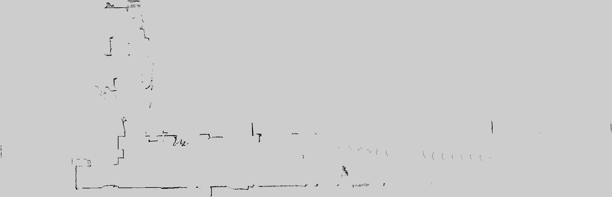
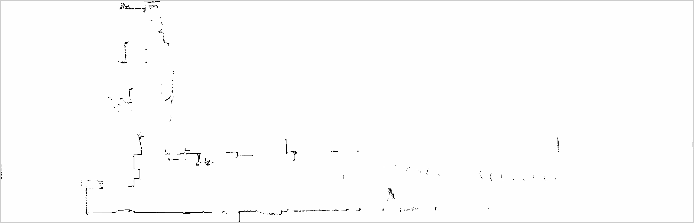

# 仙工SMAP地图转换为Nav2地图

工具：`tools/convert_seer_smap.py`。支持带`header`、`normalPosList`的JSON格式二维SMAP，不支持加密、压缩或其他未识别的格式。原始文件只读，转换输出到工作区。

## 使用

依赖系统Python和Pillow；本机已安装。工作区根目录执行：

```bash
/usr/bin/python3 tools/convert_seer_smap.py \
  /opt/Roboshop/bin/location/appInfo/robots/All/2D0024001647393436343431/maps/20251120141209997.smap \
  --output-prefix maps/seer/20251120141209997
```

输出同名前缀的四个文件：

- `.pgm`：Nav2占用地图。黑色0为障碍、灰色205为未知、白色254为明确指定的空闲区域。
- `.yaml`：分辨率、地图原点和图像文件名；与PGM一起保存。
- `.png`：地图预览，坐标方向与PGM一致，顶部为Y正方向。
- `.report.json`：输入来源、范围、栅格统计和未转换字段。

再次输出到同一前缀默认报错，使用新名字或明确加`--overwrite`覆盖。

## 不能从缺失数据推断空闲区域

这份SMAP包含4787个普通障碍点和99条`FeatureLine`，没有完整的逐格空闲/未知信息。工具只把普通点栅格化为障碍，其余保持未知，不自动连接点、不封闭缺口，也不把高级特征线当作实体墙。路线、站点、限速区、禁行区等仙工语义不会自动迁移到Nav2。

默认结果可用于地图预览和后续处理，但不属于已经确认可以导航的地图；当前项目的规划器`allow_unknown: false`，不会把未知区域当作可行通道。不要通过全部涂白或开启未知区域规划来代替实际通行范围确认。

若现场已明确确认一块区域可以通行，可以提供地图坐标系中的多边形顶点JSON文件：

```json
[[1.0, 1.0], [2.0, 1.0], [2.0, 2.0], [1.0, 2.0]]
```

以上只是格式示例，不代表本场地的可通行区域。顶点按边界顺序给出，组成不自交的简单多边形，单位为米；必须位于SMAP范围内。该区域内部会标为空闲，原有障碍点仍保留，外部仍为未知。区域应依据现场检查或已有完整地图确定，不能仅根据点云间的空白判断。

```bash
/usr/bin/python3 tools/convert_seer_smap.py /path/to/input.smap \
  --output-prefix maps/seer/confirmed \
  --free-polygon /path/to/confirmed_free_area.json
```

预览图会额外用绿色线标记所指定区域，该线不写入PGM地图。

优先检查Roboshop是否另有完整栅格地图导出功能；若有，使用厂商提供的已知空闲区域，比从点地图人工重建更完整。

## 坐标与实际接入

保留SMAP的米制坐标和分辨率，并在边界增加两格未知余量。YAML原点是图像左下角，PGM第一行是地图北侧，转换处理了图像行与Y坐标方向相反的问题。没有给这张实景地图套用仿真的`[-4,-4,0]`初始位姿。

实际接入还需要与该地图匹配的真实激光、里程计、TF和初始定位。当前Gazebo场景与实景不同，不能只替换地图就期待模拟雷达与实景墙体匹配。原始SMAP也不会自动生成对应Gazebo世界。

## 本次转换与验收

输出位于`maps/seer/20251120141209997.*`，保留0.02米分辨率，尺寸1994×644；4787个障碍栅格，0个空闲栅格，其余未知。预览见：



回归检查：

```bash
/usr/bin/python3 -m unittest discover -s tools/tests -p test_convert_seer_smap.py -v
```

验证坐标方向、边界点、未知区域保留、显式空闲区域不覆盖障碍、输入不变及输出防覆盖。另使用独立ROS domain中的Nav2地图服务器检查PGM/YAML能配置、激活并读取，随后关闭验证进程。

## Roboshop界面实际导出验证（2026-11-04）

在本机Roboshop Pro v2.4.2.40中实际找到并操作的入口：进入“编辑地图”，展开顶部“导出”按钮右侧下拉菜单，选择“地图转图片”或“普通点转图片”。本机这两个入口直接打开PNG保存窗口，没有出现分辨率设置对话框；安装包中的通用导出对话框字符串不能证明当前菜单一定提供该设置。

已另存两张图，不修改或推送机器人地图：

- `maps/seer/roboshop_map_all.png`：地图转图片，包含普通点和紫色特征线等显示元素。
- `maps/seer/roboshop_map_points.png`：普通点转图片，只包含普通点的渲染结果。

两张图片尺寸都是4198×1498，RGB格式，背景主要为(249,249,249)，点/线存在抗锯齿灰度。图片尺寸也不同于原始分辨率下直接栅格化的地图。它们是地图显示内容的图片导出，没有发现配套ROS YAML或明确的未知/空闲栅格分类。因此不能将白底直接认定为实际已知空闲，或给它们机械套用0.02米/像素。原来的“需要确认可通行区域”结论仍然成立；此次界面导出没有补回SMAP中缺失的扫描自由空间信息。

## 按用户确认的“地图内部空白可通行”规则转换

用户确认本场地黑线表示墙/障碍，内部空白为可通行区域后，工具新增显式模式：

```bash
/usr/bin/python3 tools/convert_seer_smap.py \
  /opt/Roboshop/bin/location/appInfo/robots/All/2D0024001647393436343431/maps/20251120141209997.smap \
  --output-prefix maps/seer/20251120141209997_navigable \
  --assume-free-within-bounds --include-feature-lines
```

此处“内部”具体指SMAP header给出的有效矩形范围。该范围内的空白标为空闲；所有普通障碍点以及99条FeatureLine绘制为障碍；范围外增加的边缘保持未知。不改变默认保守模式，不自动猜测复杂房间的外轮廓，不连接未关联的障碍点。若有效矩形中存在不允许通行的室外空白，可改用之前的`--free-polygon`限定实际区域。

新输出`maps/seer/20251120141209997_navigable.yaml`及同名PGM/PNG/report，不覆盖之前的保守地图。原分辨率0.02米保留。此版本有5103个障碍格、1268497个空闲格、10536个未知格。它已经具备栅格规划需要的空闲区域；仍须在对应实际场地接入真实雷达、里程计与定位，不能仅通过更换地图匹配当前Gazebo的不同场景。



## 仙工定位接入

使用1004定位及连续odom构建map→odom的只读入口、地图与底盘偏移定义、时间近似和验收方法见[仙工定位接入](仙工定位接入.md)。本工具已处理图像行方向，定位世界坐标不得重复翻转Y或再次叠加YAML origin。
