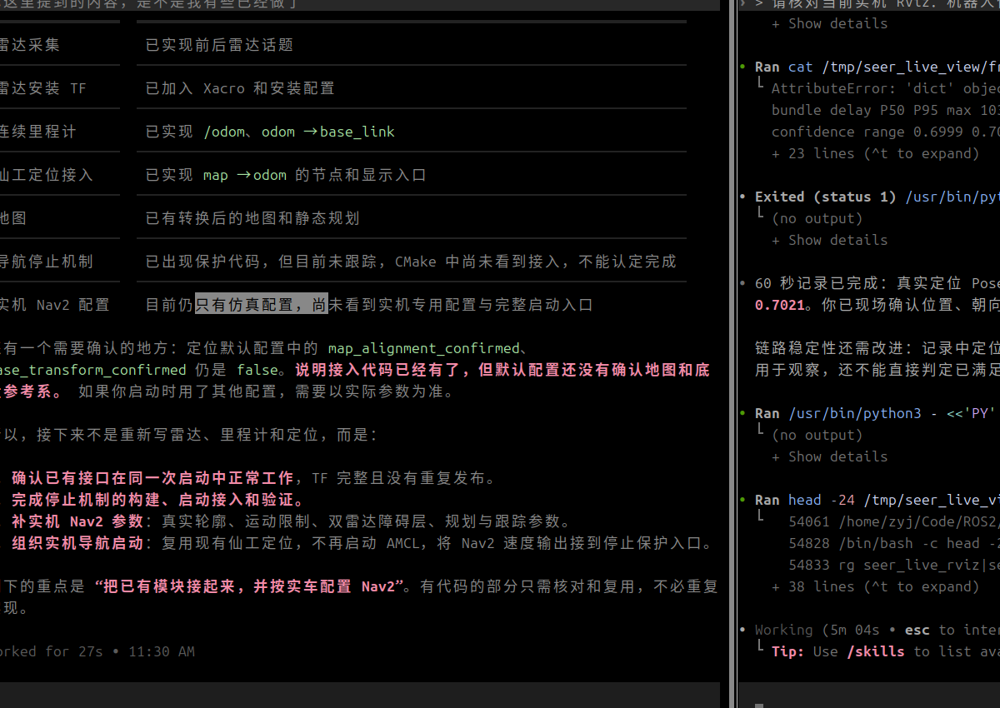

# 仙工定位实机只读复测（2026-11-12，14:11）

用户将机器人换到合适位置后进行本次复测。使用真实控制器反馈，不使用之前的合成定位演示。

## 现场核对结果

用户对当前RViz现场反馈为：**“位置朝向及雷达基本对齐”**。因此记录为本位置的只读显示和粗略叠图核对通过；尚未做独立测距、测角、点到墙残差统计，不声称达到某个厘米/角度精度，也不等于Nav2导航验收。

控制器初始只读查询：

| 字段 | 返回值 |
| --- | --- |
| current_map | 20251120141209997 |
| current_map_md5 | 342c6d27a3ad34d10d2bd44899c4578b |
| reloc_status | 1，SUCCESS |
| x / y | 0.9851 / 0.0651m |
| angle | 3.1242rad，约179°，仙工机器人参考轴 |
| confidence | 0.6999 |
| loc_method | 0，自然轮廓定位 |

使用地图对齐单位变换，base_link相对仙工机器人参考系为零平移、+π/2旋转，与既有确认版odom配置一致。因此RViz中CAD base_link的yaw约为-91°，不能把它与API原始179°直接相减判断错误。当前单位置的观察支持这套关系，但配置中的`*_confirmed=false`仍保留，未据目测将它提升为完整标定。

## 运行范围

- ROS_DOMAIN_ID=216，ROS_AUTOMATIC_DISCOVERY_RANGE=LOCALHOST，所有参与节点use_sim_time=false。
- 启动独立seer_odometry、lidar、seer_localization及地图服务器和RViz。正式定位节点仍使用默认confidence≥0.5、查询2Hz、odom插值间隔≤0.4秒等门限，并锁定上述控制器MD5；未放宽门限来强制显示。
- 模型由纯agv.xacro几何加lidar_only挂载合成，在`/live_localization`命名空间发布描述与零位关节预览；不加载ros2_control或机械臂硬件。雷达外参沿用既有配置，后部yaw及高度的标定限制仍然存在。
- 没有启动Nav2控制器、AMCL、SLAM、navigation_guard、实机运动驱动，也没有发送重定位、确认、DO、目标点或速度命令。
- 初始进程检查未发现已有实机采集/TF发布者；本次只启动一份对应节点。四条实际TF边及发布节点的后续检查见下列JSON记录。观察窗口内没有出现定位节点报告的竞争发布者错误。
- 工作区已有其他未提交修改；本次不修改这些文件、不重建或启动整机入口、不自动提交或推送。

## 60秒采集结果

[原始新鲜度与诊断记录](validation/seer_localization_live_2026-11-12_1411.json)，时长60.009秒；[TF边、发布节点和后续快照](validation/seer_localization_live_frames_2026-11-12_1411.json)。这些是观测端统计，不是设备采样时刻的真实延迟。

| 数据 | 收到条数 | 观测频率 | 到达时年龄P95 / 最大 | 最大时间戳间隔 |
| --- | --- | --- | --- | --- |
| /odom | 296 | 4.933Hz | 约0.001 / 0.001s | 0.462s |
| odom→base_link | 296 | 4.933Hz | 约0.002 / 0.002s | 0.462s |
| 前雷达 | 231 | 3.849Hz | 约0.350 / 0.921s | 约1.000s |
| 后雷达 | 231 | 3.849Hz | 约0.350 / 0.922s | 约1.000s |
| map→odom | 109 | 1.816Hz | 约0.238 / 0.313s | 2.018s |
| 定位Pose | 109 | 1.816Hz | 约0.239 / 0.314s | 2.018s |

定位置信度从0.6999到0.7021，保持高于0.5门限。定位整组查询延迟经查询计数去重抽样，P50约103.93ms、P95约361.77ms、最大约1000.74ms（包含失败）。发布时的TF/Pose年龄不包含停更期间，不能用最大0.313秒掩盖2.018秒更新空缺。

本次已经实际走通：真实1004位姿 → 底盘参考点变换 → 同时刻历史odom TF → 动态map→odom → RViz模型与真实前后雷达显示。成功更新时pose/odom查找时间相同；不能据此认为未知的控制器内部定位采样时间也与本机时钟完全一致。

## 尚未通过的稳定性项目

- 启动阶段出现1004/1000/1005/1009超时及连接失败；odom累计2次错误/重连、4次积分间隔跳过，保留degraded标志。60秒记录内这几个odom计数没有继续增长，不把启动缺口说成已恢复测量。
- 记录开始前已有5次定位查询失败，结束累计6次，记录期间新增1次；还观测到query_latency_exceeded、odom_time_gap、等待odom包围样本和stale_localization_no_republish。
- 某次odom包围间隔约0.462秒超过0.4秒门限，因此定位更新按设计丢弃。保留阈值，没有清零odom或用新时间戳重发历史定位。
- 雷达在启动连接失败后恢复，但频率低于目标5Hz，存在较长更新间隔。RViz也曾报告TF过旧和显示队列丢弃；粗略视觉对齐不代表数据持续实时。
- 当前未区分无线网络波动、控制器负载、独立连接并发和本机负载各自的贡献。此前并发试验已提示可能有影响，需要交替基线、调整采集预算或评估批量查询后复测。

结论：**本位置的实机只读显示与现场粗略叠图核对通过；通信/TF持续新鲜度仍有缺口，未完成连续导航稳定性及量化精度验收。** 后续继续人工移动/重定位、独立测量与网络/查询并发验收，方法见[仙工定位接入](仙工定位接入.md)。

本轮结束时保留实机RViz和只读采集进程供用户继续观察；进程清单在`/tmp/seer_live_view/processes.json`，不会影响控制器定位或主动移动机器人。停止时只结束该清单所属进程及其子进程，不使用全局pkill误伤其他会话。
