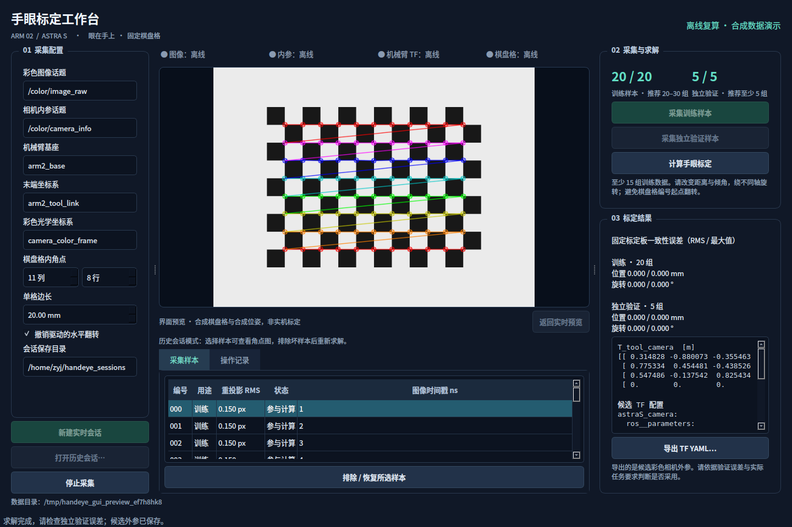

# arm2 / Astra S 眼在手上标定

默认配置对应本工程：相机固定在 `arm2_tool_link`，标定板固定在工作台；
**11 列 × 8 行内角点，单格边长 20 mm**（即 12 列 × 9 行黑白格）。
软件不发送运动指令。先手动移动机械臂，每次停稳后采集；底盘和标定板始终不动。

## 构建和启动

在工作空间根目录运行，使用系统 Python 和 ROS 2 环境：

```bash
source /opt/ros/jazzy/setup.bash
colcon build --symlink-install --packages-select handeye_calibration
source install/setup.bash
```

依赖由 `package.xml` 声明，包括 OpenCV、NumPy、PyYAML、cv_bridge、
message_filters、tf2_ros 和 std_srvs；缺失时用项目正常的 rosdep 流程安装。
先启动工程中真实机械臂状态反馈、robot_state_publisher 和相机，确认
`arm2_base -> arm2_tool_link` 来自真实关节位置，而非规划目标或模拟状态。
若相机已在运行，不要重复启动：

```bash
ros2 launch camera camera_with_tf.launch.py
```

另一个终端 source 相同环境后启动采集：

```bash
ros2 run handeye_calibration handeye_node --ros-args \
  -p board_columns:=11 -p board_rows:=8 -p square_size_m:=0.020
```

默认订阅 `/color/image_raw` 和 `/color/camera_info`，精确匹配时间戳。
默认基座 `arm2_base`，末端 `arm2_tool_link`，彩色光学坐标系
`camera_color_frame`。这些名称均可用同名 ROS 参数覆盖。

## 图形界面（推荐）



GUI 使用系统 PyQt5（`python3-pyqt5`），与 ROS 2 共用系统 Python。
构建并 source 工作空间后，启动：

```bash
ros2 run handeye_calibration handeye_gui
```

GUI 已内置同一套采集后端，无需另外运行 `handeye_node`。
相机驱动与真实机械臂状态反馈仍需启动。GUI 后端的节点名为
`handeye_calibration_gui`，私有服务位于 `/handeye_calibration_gui/`。

默认启用可靠传输（RELIABLE、KEEP_LAST 深度 1），匹配本仓库相机驱动的发布配置，
避免当前 DDS 环境中大尺寸图像使用 best-effort 时发生接收停滞。
若换用只发布 best-effort 的其他相机驱动，需取消「可靠传输」勾选，
或在命令行节点中设置 `-p reliable_transport:=false`；否则 QoS 不兼容，会收不到数据。

操作流程：

1. 左侧确认图像话题、坐标系与棋盘格尺寸，点击「新建实时会话」。
2. 上方状态显示图像、内参、机械臂 TF 是否就绪；中间预览角点检测。
   图像显示按约 30 FPS 刷新，只保留最新帧，旁边显示实际帧率与显示时图像的年龄。
   角点在独立线程中对最多 480 像素宽的图像检测，最高约 5 Hz；
   同时最多一个检测任务，不积压检测请求。缓存角点叠加最多保留 0.4 秒，
   快速移动时可能暂时滞后，仅作预览参考。
   采样仍用原始分辨率进行 SB 角点检测及 PnP 检查。
   预览角点未检出不会直接禁止采样，最终以采样检查结果为准。
3. 停稳机械臂，分别点击「采集训练样本」「采集独立验证样本」。
4. 点击样本表格的行查看已保存的角点图；「返回实时预览」恢复相机画面。
   使用「排除 / 恢复所选样本」管理坏样本，保留原始图像和记录。
5. 至少 15 组有效训练样本后，点击「计算手眼标定」，右侧查看训练和独立验证误差。
6. 点击「导出 TF YAML…」选择候选配置保存位置。GUI 不主动发布或应用外参。

实时预览直接读取最新图像，不依赖内参或机械臂连接。
正式采样仍要求图像、内参精确匹配时间戳，并查询该时刻的机械臂 TF；
这些条件缺失时，采样按钮禁用。
采样、排除或恢复样本后，界面会清除旧的计算结果，需重新求解后才能再次导出。
计算和 ROS 回调运行于后台线程，不阻塞窗口。

点击「停止采集」后可以新建会话，或「打开历史会话…」选择已有 `session.json`：
历史模式无需连接硬件，可查看样本、排除/恢复样本并离线复算。
历史模式中的样本排除操作会直接保存回所打开的 `session.json`；
求解会更新该目录下的候选结果。需要保留原版本时，先复制整个会话目录。
历史结果不会未经重新求解就显示成当前可导出的结果。

已停止或过期的图像会保留最后一帧供查看，是否在线应以上方状态为准。
视频停止后，帧率会降至 0，而不是保留最后一次的高帧率读数。

后端每 0.5 秒检查接收状态：当话题仍存在发布者、但超过 2 秒没有收到图像或内参回调时，
自动重建两路订阅和时间同步器，重试间隔至少 5 秒，保留已采集的标定样本。
界面也提供「重新订阅相机数据」按钮。这个恢复过程只重建 ROS 订阅，不重启相机驱动。
判断接收中断使用单调时钟；仍持续收到数据但时间戳异常时，会单独提示，
不会靠放宽时间限制允许过期样本进入标定。

可只读查询接收计数、最后接收间隔、图像时间戳年龄与重订阅次数：

```bash
ros2 service call /handeye_calibration_gui/status std_srvs/srv/Trigger '{}'
```

独立命令行后端的同名服务位于 `/handeye_calibration/status`。

## 采集、求解与验证

1. 检查彩色内参和畸变系数确实匹配当前分辨率。内参不准确时，先做相机内参标定。
2. 每次停稳后采集一组，推荐 20～30 组训练数据，至少 15 组：

   ```bash
   ros2 service call /handeye_calibration/capture std_srvs/srv/Trigger '{}'
   ```

3. 改变距离、位置和倾角，让末端绕不同方向旋转，避免仅平移或只绕一个轴。
   完整棋盘格始终在视野内。普通棋盘格存在角点编号对称歧义，保持同一面朝向相机，
   不要在画面内旋转接近 180°；检查保存的 `_corners.png`，保持编号起点对应同一物理角。
   如果编号翻转，该样本不可混入求解，应重新采集或离线剔除。
4. 另外采集至少 5 组新姿态作为验证数据，不参与拟合：

   ```bash
   ros2 service call /handeye_calibration/capture_validation std_srvs/srv/Trigger '{}'
   ros2 service call /handeye_calibration/solve std_srvs/srv/Trigger '{}'
   ```

失败会返回原因，如图像过期、缺少对应时刻的 TF、角点不全或重投影误差大。
图像应在停稳后获取；本节点不自动检测机械臂是否停稳。驱动时间戳是发布时刻，
不是硬件曝光时刻，所以停稳采集也是降低时间偏差影响的必要条件。

数据保存在 `~/handeye_sessions/<时间>/`，可用 `output_directory` 参数修改。
每组保存原图、标注图、角点、内参、时间戳、机械臂位姿和标定板位姿。

输出：

- `session.json`：原始采样信息，可修改副本剔除坏样本后复算。
- `result.json`：`T_tool_camera` 及训练/独立验证误差。
- `camera_tf_candidate.yaml`：候选彩色相机外参，单位米，四元数 xyzw。

离线复算，不需要连接硬件：

```bash
ros2 run handeye_calibration handeye_solve /完整路径/session.json
```

误差计算为每个姿态的 `T_base_tool @ T_tool_camera @ T_camera_board`，
与第一组训练数据算出的固定标定板位姿比较，报告位置和旋转的 RMS、最大值。
这是固定板一致性指标，不代表绝对抓取精度。验证误差应满足实际任务要求；
没有验证样本时输出 `validation: null`，不能据此确认标定成功。
求解服务成功仅表示已产生候选结果，不表示通过精度验收。

## 本工程相机注意事项

- `camera/src/nodes/astras_node.cpp` 在发布前水平翻转图像，但仍使用原始内参。
  本采集器默认 `undo_horizontal_flip:=true`，检测前撤销该次翻转。
  若换成未翻转的驱动，设置 `-p undo_horizontal_flip:=false`。
  此补偿只针对驱动中显式的 `cv::flip`，还应确认 SDK 没有额外镜像。
  后续视觉定位也必须使用与标定一致的图像和内参约定。
- 不使用现有相机静态 TF 参与求解，仅查询机械臂基座到末端的 TF。
  输出对应 PnP 光学坐标系：x 向右、y 向下、z 向前。
- 此处末端是 `arm2_tool_link`，不是控制器上任意配置的 TCP。
  若改用控制器反馈，需要先统一参考基座与 TCP 定义。
- 全流程使用米。不要再经过已有 `handeye_txt2yaml.py` 的毫米转米步骤。
- 不自动覆盖 `camera/config/camera_tf.yaml`，也不发布候选 TF。
  验证合格后可人工把候选外参写入工程配置，重建 camera 包并重启相机。
- 当前相机节点把相同外参同时发布给彩色和深度坐标系。
  本次只标定彩色光学坐标系，不能据此认为原始深度光学坐标系已标定。
  只有确认深度已配准到彩色坐标系时才可共用，其他情况需单独接入 RGB/深度外参。

## 验证软件

```bash
source /opt/ros/jazzy/setup.bash
PYTHONPATH="src/handeye_calibration:$PYTHONPATH" /usr/bin/python3 -m pytest \
  src/handeye_calibration/test -q
```

合成数据测试验证变换方向、单位、四元数、独立验证误差与退化姿态拒绝；
GUI 测试使用 Qt offscreen 模式，覆盖历史会话求解、样本排除、导出、
无相机提示及后台线程退出；性能回归模拟 300 毫秒的慢角点检测，
验证视频仍持续刷新，并检查帧缓存与检测任务都不会积压。
实机精度需要上述实际采集流程确认。
